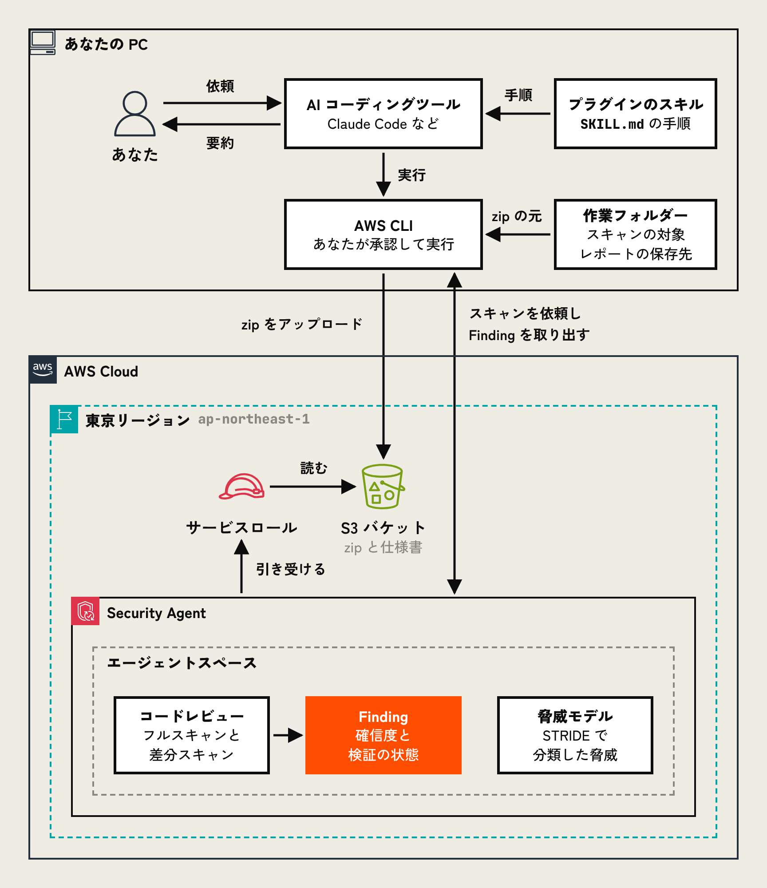
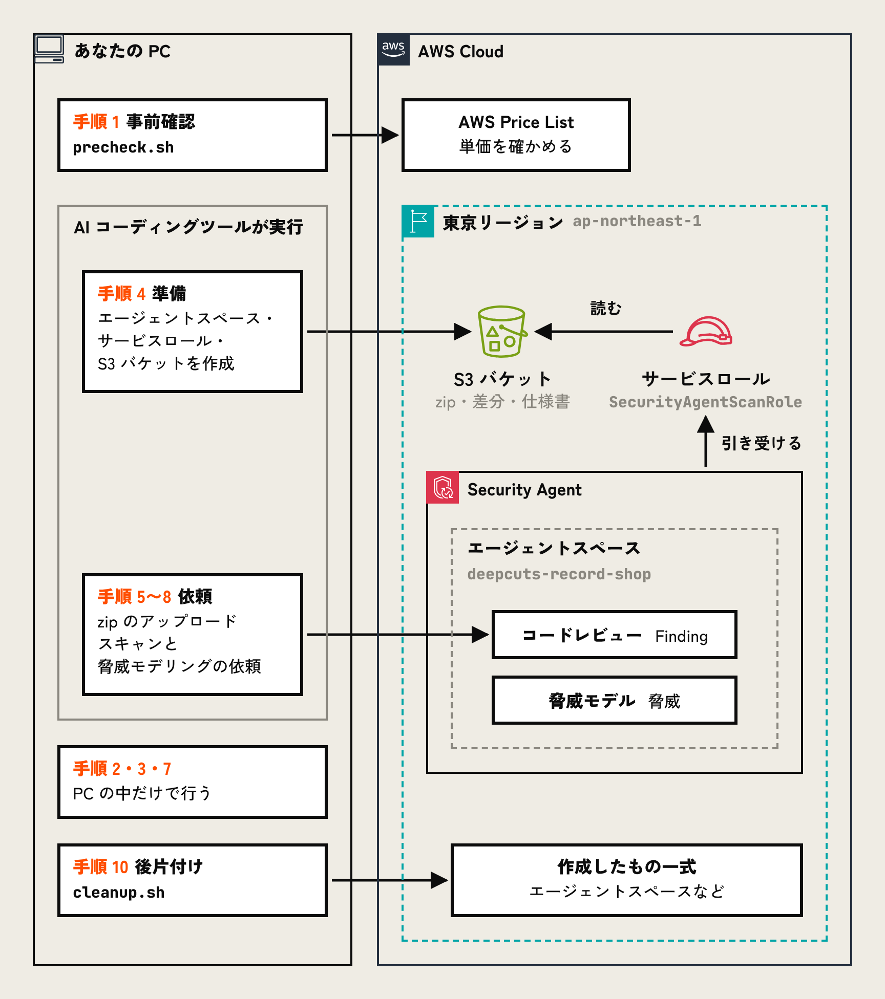
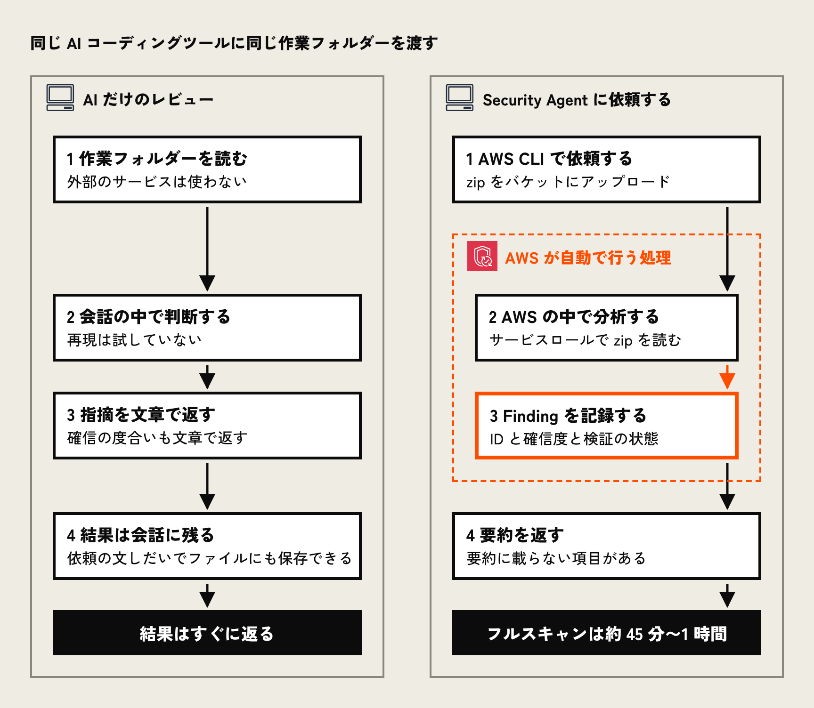
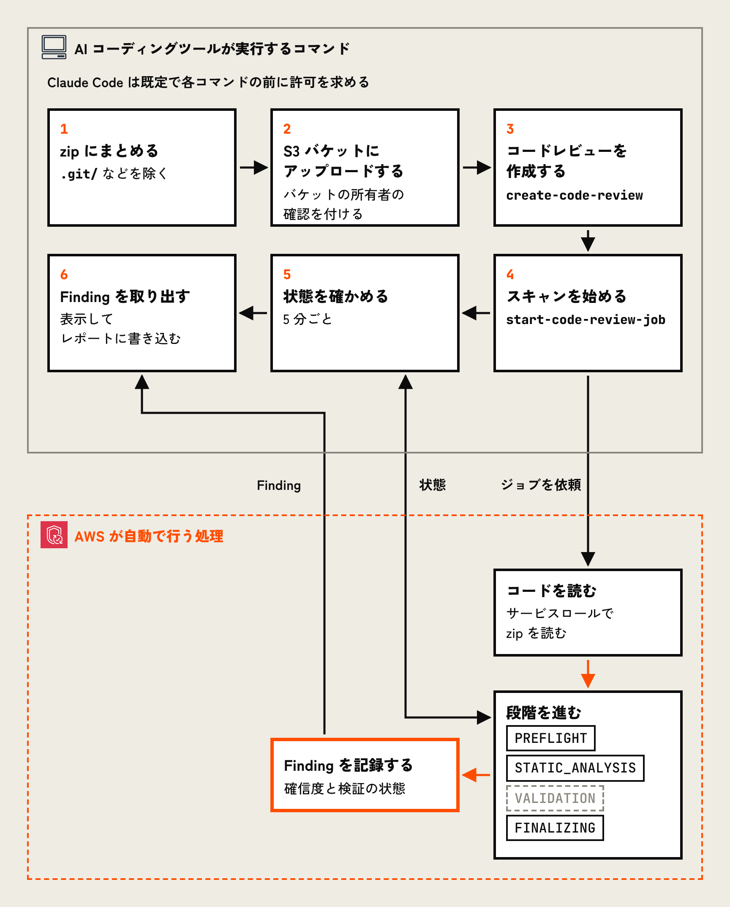
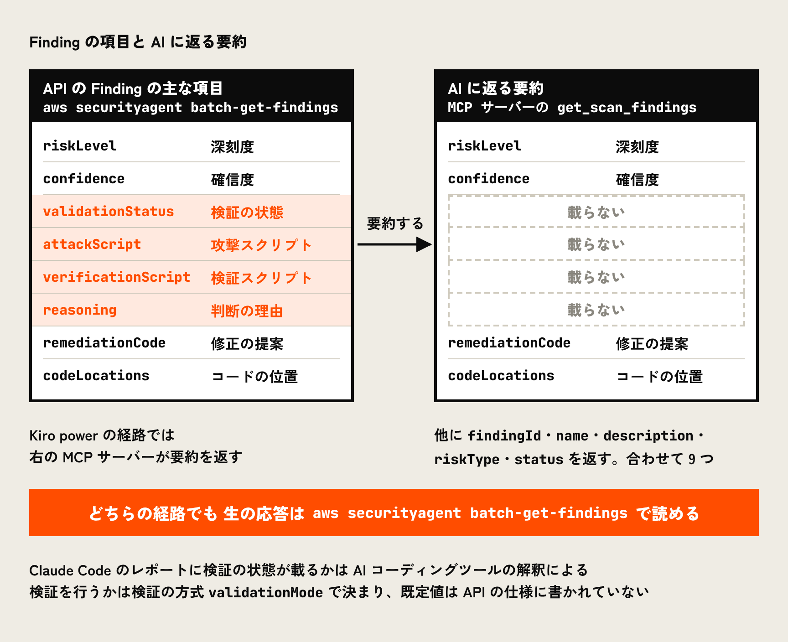
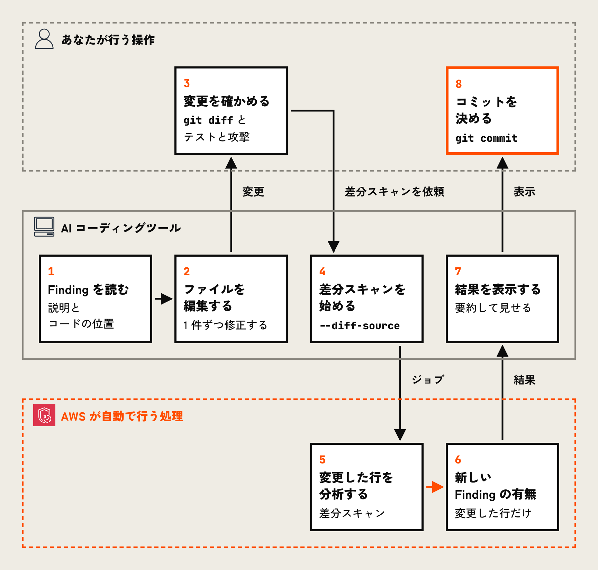
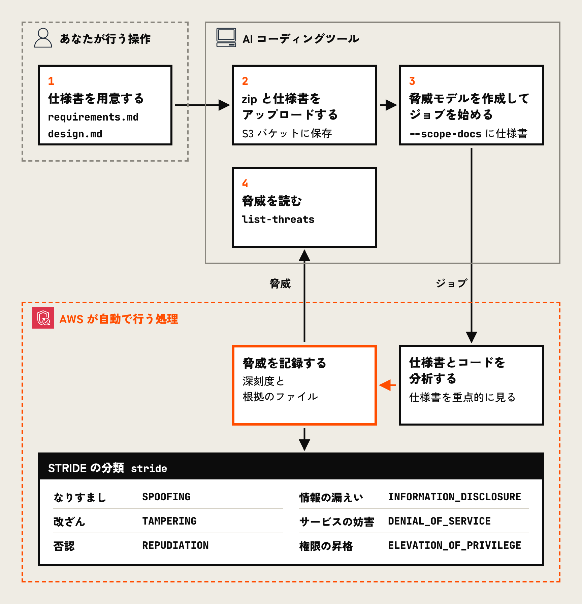

このリポジトリは AWS Deep Cuts の、AWS Continuum に関するハンズオンコンテンツです。

<!-- TODO: 記事の公開後に、次の行のリンクを有効にする -->
<!-- AWS Continuum の解説記事(Qiita)は[こちら]() -->

解説記事の原稿は [article/aws-continuum.md](./article/aws-continuum.md) にあります。

<!-- TODO（公開前に著者が確認）: 次の 4 つを実機で確かめるまで、この README を公開しない。(1) 東京で、プラグインの準備・フルスキャン・差分スキャン・脅威モデリングが通ること。通らなければ us-east-1 で行い、リージョンの記述を修正する。(2) コンソールで Security Agent を一度も設定していないアカウントで、手順 4 の準備が通るか。(3) 後片付けの翌日の請求で、使用タイプ APN1-repository-code-review と APN1-Threat-Modeling が 0.00 USD で計上されていること。(4) Claude Code でのプラグインの導入の表示と、スキルが実際に実行したコマンド。手順 4・5・7・8 のコマンドの表を、実際のコマンドに合わせて修正する -->

> **Note**: AWS Continuum は、セキュリティの作業を行う AWS の AI エージェントの機能をまとめた総称です。AWS の発表によると、2026 年 6 月に発表されました。AWS の公式のガイドは、製品とコンソールの名前は、機能の統合に伴って変わりうると注意しています。
> - このハンズオンの主役は、AWS Continuum に含まれる AWS Security Agent の **コードレビュー** と **脅威モデリング** です。この README では、AWS Security Agent を Security Agent と書きます。Security Agent の API と AWS CLI のコマンドの名前は `securityagent` です。
> - 操作は、あなたの PC のターミナルと、あなたが普段使っている AI コーディングツールで行います。AI コーディングツールは、コードを読み書きし、コマンドの実行まで行う AI のツールです。この README の手順は、Claude Code で書いています。Claude Code では、AWS が公式に公開しているプラグイン `aws-agents-for-devsecops` を使います。Kiro については、[Kiro で行う場合](#kiro-で行う場合) で、公式の資料に書かれている方法を紹介します。
> - リージョンは東京 `ap-northeast-1` です。2026 年 11 月 4 日の時点で、Security Agent の API のエンドポイントは東京にあり、AWS Price List にも東京のコードレビューと脅威モデリングの単価があります。<!-- 要確認: 東京でコードレビューと脅威モデリングを使えるか。機能ごとの提供リージョンの表は確かめられていない -->
> - AWS CLI は、Security Agent の脅威モデリング・差分スキャン・予算の上限に対応した v2.36.23 以降が必要です。

> ⚠️ **コストに関する注意**
>
> Security Agent のコードレビューと脅威モデリングの単価は、2026 年 11 月 4 日時点の AWS Price List で、東京リージョンで **$0.00/時** です。AWS の発表によると、どちらもプレビュー中で、プレビューの間は追加料金がかかりません。一般提供の後の単価は分かりません。そのため、手順 1 の `precheck.sh` は、始める前に AWS Price List を読み、2 つの単価が $0.00 でなければ何もせずに止まります。
>
> | 場面 | 概算 |
> | --- | --- |
> | 手順どおりに行った場合 | Price List の単価が $0.00/時のままであれば、AWS の費用は S3 と CloudWatch Logs の分だけで、**$0.01 未満**（約 2 円未満）の見込みです。ログの量は 1 MB 未満と仮定しています。実際の請求は、手順 10 の最後に書いた方法で、翌日に確かめます |
> | 後片付けを忘れて 1 か月放置した場合 | $0.01 未満。Security Agent の Price List には、作業の時間の他に料金の項目がありません。S3 バケットの中身は 30 日で消えます |
> | Security Agent の単価が $0.00 でなくなった場合 | 手順 1 の `precheck.sh` が止まります。そのまま続けると、この README の見積もりは当てはまりません |
> | AI コーディングツールの利用料 | あなたの契約によります。AWS の費用ではありません |
> | 任意の発展として有料の CV を試す場合 | 約 $20〜$60、仮定に基づく最大は約 $260。[発展の README](hands-on/optional-cv/README.md) の冒頭で、別に了承してください |
>
> この金額は、1 ドル 160 円で換算しています。内訳は [費用の見積もり](#費用の見積もり) にあります。
>
> Security Agent には、動いているアプリに実際に攻撃を試す **侵入テスト** の機能もあります。侵入テストの単価は 1 時間あたり $50 です。このハンズオンでは侵入テストを行いません。AI コーディングツールに侵入テストを頼まないでください。
>
> **検証が終わったら速やかに後片付けを実施し、翌日に請求を確認してください。**

# AWS Deep Cutsとは
AWS Deep Cutsは、AWS の最新のサービスやニッチな機能、または高度にアカデミックな知識を要求するサービスなど、多くの人が知らない 『隠れた名曲 = **Deep Cuts**』 を深くまで掘り下げる技術シリーズです。

このようなサービスはWeb情報も少なく、初学者は気軽にキャッチアップできないのが実情です。

そこで AWS Deep Cuts シリーズでは、**前提知識も含めた分かりやすいサービス解説** と **手順通りに進めれば誰でも再現できるハンズオン** を提供します！

# ハンズオンのゴール

このハンズオンでは、小さなレコード店のアプリを、あなたの PC の作業フォルダーに複製します。そして、同じ AI コーディングツールに、2 つの方法で脆弱性を探させて比べます。1 つ目は、AI コーディングツールがファイルを読むだけで判断する方法です。この README では、これを **AI だけのレビュー** と呼びます。2 つ目は、AI コーディングツールが Security Agent に依頼し、AWS の中で分析させる方法です。

アプリには、学習のために意図的に入れた脆弱性が 2 つと、危険に見えるが対策済みのコードが 1 つあります。全体の流れは、次の図のとおりです。



AI コーディングツールは、プラグインのスキルに書かれた手順に従って AWS CLI のコマンドを実行し、Security Agent に作業を依頼します。分析は AWS の中で Security Agent が行い、AI コーディングツールは結果を受け取って要約します。あなたは、AI コーディングツールが実行するコマンドを 1 つずつ読んでから承認し、別のターミナルで、作成されたものを AWS CLI とコンソールで確かめます。

次の表で確かめる特徴をまとめます。表の中の Finding は、Security Agent のスキャンが報告した脆弱性 1 件の記録です。エージェントスペース・確信度・検証の状態などの用語は、それぞれの手順で説明します。

| 確かめる特徴 | 手順 |
| --- | --- |
| Security Agent の単価が $0.00/時であることを、AWS Price List で自分で確かめられる | 1 |
| AI だけのレビューは、ファイルを読むだけで、すぐに指摘を返す | 3 |
| プラグインのスキルに従って、AI コーディングツールが AWS CLI でエージェントスペース・ロール・バケットを作成する | 4 |
| スキャンの分析は AWS の中で行われ、AI コーディングツールは依頼と取りまとめを行う | 5 |
| Finding は確信度と検証の状態を持つ。AI の要約に載らない項目を、API の応答で読める | 6 |
| AI コーディングツールが修正の提案をもとに手元のファイルを修正し、あなたが差分・テスト・攻撃の確認を行い、差分スキャンで確かめる | 7 |
| 仕様書から、STRIDE で分類した脅威を作成できる | 8 |

最後に、手順 9 の採点表で、あなたの予想・AI だけのレビュー・Security Agent の結果を比べます。

用語の意味と仕組みは、解説記事で説明しています。先に記事の「AWS Continuumとは？」と「仕組み」を読んでおくと、各手順で何を確かめているのかが分かりやすくなります。記事の説明用の例は、このハンズオンのアプリとは別のアプリです。記事を読んだ後でも、手順 2 の予想は成り立ちます。

## 所要時間の目安

| 部分 | 目安 | 待つ間にできること |
| --- | --- | --- |
| 手順 1〜4 | 約 45 分 | |
| 手順 5 のフルスキャン | スキルの記述で約 45 分、ユーザーガイドによると約 1 時間 <!-- 要確認: 著者の実測。ユーザーガイドの所要時間は検索の要約で確かめた値 --> | AI コーディングツールに「確認をやめて」と頼み、PC を離れてよい。スキャンは AWS の中で進む |
| 手順 6 | 約 20 分 | |
| 手順 7 | 約 30 分。差分スキャンは、スキルの記述で数分、ユーザーガイドによると 5〜15 分 | |
| 手順 8 | ユーザーガイドによると脅威モデリングは 5〜30 分。結果を読むのに約 15 分 | |
| 手順 9〜10 | 約 20 分 | |

途中で中断した場合は、新しいターミナルで [ハンズオンの進め方](#ハンズオンの進め方) の「準備のコマンド」を実行してから、続きの手順に進んでください。Claude Code は作業フォルダーで起動し直し、「前回の Security Agent のスキャンの状態を見せて」と頼みます。プラグインのスキルは、作業フォルダーの `.security-agent/scans.json` に記録したスキャンを読み、状態を確かめます。

# ハンズオン手順

以降の手順は、ハンズオン用に用意した AWS アカウントで実施してください。

## 構築するアーキテクチャ



図の番号は、この README の手順の番号です。

- 手順 1 では、あなたが実行する `precheck.sh` が、AWS Price List で Security Agent の単価を確かめます。AWS には何も作成しません。
- 手順 4 では、AI コーディングツールが、プラグインのスキルに従って AWS CLI のコマンドを実行し、エージェントスペース・サービスロール・S3 バケットを作成します。Claude Code は、既定の設定では、多くのコマンドについて、実行する前にあなたの承認を求めます。
- 手順 5〜8 では、AI コーディングツールが、作業フォルダーを zip にして S3 バケットに保存し、Security Agent にスキャンと脅威モデリングを依頼します。Security Agent は、サービスロールを引き受けて、バケットの zip を読みます。IAM ロールを引き受けるとは、AWS のサービスが、そのロールに付いた権限を一時的に使って AWS を操作することです。
- 手順 2・3・7 のアプリの起動・テスト・攻撃の確認は、あなたの PC の中だけで行います。AWS には何も送りません。
- 手順 10 では、あなたが実行する `cleanup.sh` が、このハンズオンで作成されたものを消します。

このハンズオンで作成されるものは、次のとおりです。

| 作成されるもの | 誰が作成するか | 削除の方法 |
| --- | --- | --- |
| エージェントスペース `deepcuts-record-shop`。中に、コードレビュー・スキャンのジョブ・Finding・脅威モデル・脅威が属する | AI コーディングツール。手順 4・5・7・8 で、あなたが承認する | `cleanup.sh` |
| IAM ロール `SecurityAgentScanRole` とインラインポリシー | AI コーディングツール。手順 4 | `cleanup.sh`。前からあった場合は消さない |
| S3 バケット `security-agent-scans-<アカウント ID>-<リージョン>`。中に、zip・差分・仕様書が入る | AI コーディングツール。手順 4 | `cleanup.sh`。前からあった場合は消さない |
| CloudWatch Logs のロググループ。作成された場合だけ | Security Agent | `cleanup.sh` |
| 作業フォルダー `~/deepcuts-record-shop` と、その中の `.security-agent/` | `make-workspace.sh` と AI コーディングツール | あなたが `rm -rf` で消す |
| 記録フォルダー `~/deepcuts-results` | `precheck.sh` とあなた | あなたが `rm -rf` で消す |
| AI コーディングツールのプラグイン | あなた | 任意 |

侵入テスト・GitHub などのリポジトリとの連携・KMS のキーは作成しません。

## 前提条件

- **ハンズオン用に用意したあなたの AWS アカウント** で行うこと。Security Agent をすでに使っているアカウントは避けてください。手順 4 のスキルは、IAM ロール `SecurityAgentScanRole` が既にあると、その信頼ポリシーと許可を上書きします。また、手順 10 の `cleanup.sh` は、`precheck.sh` の後に作られた `/aws/securityagent` で始まるロググループと、名前が `deepcuts-record-shop` か `security-scans` のエージェントスペースを、このハンズオンのものとして消します。同じアカウントで他の人が Security Agent を使っていると、そのリソースも消える場合があります。`cleanup.sh` は、消す前に対象の一覧を表示し、あなたの確認を求めます。
- **Claude Code** が使えること。プラグインをインストールする `/plugin` のコマンドを使います。Claude Code の利用料は、あなたの契約によります。
- **AWS CLI v2** が 2.36.23 以降であること。できれば最新版にしてください。それより古い AWS CLI では、手順 5-2 で読む `maxTaskHours` が出力に現れません。手順 1 の `precheck.sh` が、接続せずにコマンドと項目の有無を確かめます。
- AI コーディングツールを起動するターミナルで、`aws sts get-caller-identity` が成功すること。`aws login`・IAM Identity Center・プロファイルなど、普段の方法でサインインしてかまいません。
- 学習用のアカウントの管理者の権限で行うこと。`AdministratorAccess` 相当の権限で行うのが簡単です。
- `git`・`python3`・`zip`・`curl` があること。Python は 3.9 以上が必要です。
- OS は macOS・Linux・Windows の WSL のいずれか。macOS には `md5sum` がありません。プラグインのスキルは、作業フォルダーの ID を `md5sum` で作成します。`brew install coreutils` でインストールしておくと確実です。<!-- 要確認: md5sum が無いときに、AI が別のコマンドに置き換えるか -->

<details>
<summary>権限の参考</summary>

AWS Labs が公開している Security Agent の MCP サーバーの README には、利用者の認証情報に要る権限が、次のように書かれています。最小権限のポリシーを作成するときの参考にしてください。

| 用途 | README に書かれている権限 |
| --- | --- |
| 準備 | `iam:CreateRole`、`iam:PutRolePolicy`、`s3:CreateBucket`、`s3:PutPublicAccessBlock`、`s3:PutLifecycleConfiguration`、`sts:GetCallerIdentity`、`securityagent:CreateAgentSpace`、`securityagent:UpdateAgentSpace`、`securityagent:ListAgentSpaces`、`securityagent:BatchGetAgentSpaces` |
| スキャン | `s3:PutObject`、`securityagent:CreateCodeReview`、`securityagent:StartCodeReviewJob`、`securityagent:BatchGetCodeReviewJobs`、`securityagent:StopCodeReviewJob`、`securityagent:ListFindings`、`securityagent:BatchGetFindings`、`securityagent:StartCodeRemediation`、`securityagent:BatchDeleteCodeReviews` |

このハンズオンでは、これらに加えて、脅威モデリング・一覧の取得・削除の操作と、IAM と CloudWatch Logs の読み取りと削除の権限を使います。

<!-- 要確認: 脅威モデリングと削除の操作の権限の名前、iam:PassRole が要るか。README の s3:PutPublicAccessBlock は、IAM のポリシーに書くアクションの名前としては s3:PutBucketPublicAccessBlock の可能性がある -->
</details>

## ハンズオンの進め方

このハンズオンでは、ターミナルを 2 つ使います。

| ターミナル | 使い方 |
| --- | --- |
| ターミナル 1 | AI コーディングツールを動かします。AI コーディングツールに頼む言葉は、この README に載せた文をそのまま使ってください。読者どうしで結果を比べられるようにするためです |
| ターミナル 2 | あなたが AWS CLI のコマンドを実行し、AI コーディングツールが作成したものを自分で確かめます |

**準備のコマンド**: 手順 2 以降は、どちらのターミナルでも、開いたら最初に次のコマンドを実行してください。プラグインのスキルが実行するコマンドには `--region` が付いていません。そのため、AWS CLI は環境変数のリージョンを使います。この README のターミナル 2 のコマンドも、同じ環境変数を使います。

```bash
export AWS_REGION=ap-northeast-1 AWS_DEFAULT_REGION=ap-northeast-1 AWS_PAGER=""
source ~/deepcuts-results/resource-ids.env
cd ~/deepcuts-record-shop
```

**AI コーディングツールのコマンドの承認**: Claude Code は、既定の設定では、多くのコマンドについて、実行する前に、実行してよいかをあなたに聞きます。<!-- 要確認: Claude Code の実機で、aws コマンドと作業フォルダーの外への書き込みで許可を求められるか -->各手順の「AI コーディングツールが実行するコマンド」の表と照らし合わせ、コマンドを読んでから承認してください。コマンドを自動で承認する設定では使わないでください。何が実行されたかが分からなくなります。

**ID の記録**: 作成されたリソースの ID は、記録フォルダーの `resource-ids.env` に追記します。`--output text` は、値が無いと文字列の `None` を返します。そのため、ID を取り出した直後に、次の形の 1 行で、値があるときだけ追記します。

```bash
[[ -n "${X}" && "${X}" != "None" ]] && echo "X=\"${X}\"" >> ~/deepcuts-results/resource-ids.env || echo "⚠️ X を取り出せませんでした。トラブルシューティングを見てください"
```

出力例は、すべて出力の形の例です。ID などの値は、環境ごとに異なります。また、Security Agent と AI コーディングツールの判断は、毎回同じとは限りません。そのため、AI の判断に関わる期待する結果は、「予想」と「観察する項目」で書いています。

## １．事前準備

このハンズオンの前提を確かめる作業と、作業フォルダーを作成する作業は、ハンズオンの本質ではないため、2 つのスクリプトで行います。どちらも AWS には何も作成しません。

```bash
# このリポジトリをクローン
git clone https://github.com/AWS-Deep-Cuts/aws-continuum ~/aws-continuum
cd ~/aws-continuum/hands-on

# リージョンを設定して、事前確認のスクリプトを実行
export AWS_REGION=ap-northeast-1 AWS_DEFAULT_REGION=ap-northeast-1 AWS_PAGER=""
bash ./precheck.sh

# 以下の文言が表示されれば事前確認は成功です
# ✅ 事前確認が完了しました（AWS には何も作っていません）

# 作業フォルダーを作るスクリプトを実行
bash ./make-workspace.sh

# 以下の文言が表示されれば成功です
# ✅ 作業フォルダー /Users/<あなた>/deepcuts-record-shop を作りました
```

`precheck.sh` は、次のことを確かめます。

| 確かめること | 方法 | 止まる条件 |
| --- | --- | --- |
| リージョンの環境変数 | `AWS_REGION` と `AWS_DEFAULT_REGION` | `AWS_REGION` が無い。2 つの値が違う |
| 道具 | `aws`・`git`・`python3`・`zip`・`curl` | どれかが無い。`md5sum` が無いときは警告だけ |
| 認証情報 | `aws sts get-caller-identity` | 失敗する |
| AWS CLI の機能 | `create-threat-model`、`start-code-review-job` の `--diff-source`、`create-code-review` の `maxTaskHours` と `validationMode` があるか。接続せずに確かめる | どれかが無い |
| **Security Agent の単価** | AWS Price List の東京の価格表 | コードレビューか脅威モデリングの単価が $0.00 でない |
| Security Agent を呼び出せるか | `aws securityagent list-agent-spaces` | 失敗する |
| 前からあるリソース | ロール `SecurityAgentScanRole`、プラグインが使うバケット、Kiro の経路の MCP サーバーが使うバケット、エージェントスペース、ロググループ。Claude Code の経路では、2 つ目のバケットは作成されない見込み | ロールが既にある。同じ名前のバケットを他のアカウントが持っている。エージェントスペースかロググループの一覧を取得できない |

`precheck.sh` は、確かめた結果を記録フォルダー `~/deepcuts-results/resource-ids.env` に書きます。`cleanup.sh` は、この記録を読み、前からあったものを消さずに、このハンズオンで作成されたものだけを消します。

| 変数 | 中身 | 使う手順 |
| --- | --- | --- |
| `REGION` | リージョン `ap-northeast-1` | すべて |
| `ACCOUNT_ID` | AWS アカウントの ID | 4・5 |
| `PRECHECK_AT` | `precheck.sh` を実行した日時。協定世界時 | 10 |
| `PRICE_PUBLICATION` | 確かめた Price List の公開日時 | 1 |
| `SCAN_BUCKET` | プラグインが使うバケットの名前 `security-agent-scans-<アカウント ID>-<リージョン>` | 4・5・7・8 |
| `TM_BUCKET` | Kiro の経路の MCP サーバーが使う 2 つ目のバケットの名前 | 10 |
| `PRE_ROLE`・`PRE_SCAN_BUCKET`・`PRE_TM_BUCKET` | ロールとバケットが前からあったか。1 はあった、0 は無かった | 10 |
| `PRE_AGENT_SPACES`・`PRE_LOG_GROUPS` | 前からあったエージェントスペースの ID と、ロググループの名前 | 10 |
| `WORKSPACE` | 作業フォルダーの場所 | 10 |

以降の手順で、`AGENT_SPACE_ID`・`CODE_REVIEW_ID`・`JOB_ID_FULL`・`JOB_ID_DIFF`・`THREAT_MODEL_ID`・`THREAT_JOB_ID` を追記していきます。

### 1-1. Price List の単価を自分で確かめる

`precheck.sh` が読んだ AWS Price List を、あなたも 1 回読んでみてください。AWS Price List は、AWS のサービスの単価を JSON で公開している価格表です。

```bash
curl -s "https://pricing.us-east-1.amazonaws.com/offers/v1.0/aws/SecAgent/current/${AWS_REGION}/index.json" \
  | python3 -c 'import json,sys; d=json.load(sys.stdin); u={k:v["attributes"]["usagetype"] for k,v in d["products"].items()}; [print(u[s], p["pricePerUnit"]["USD"], p["unit"]) for s,t in d["terms"]["OnDemand"].items() for x in t.values() for p in x["priceDimensions"].values()]; print("publicationDate:", d["publicationDate"])'
```

2026 年 11 月 4 日に実行したときの出力は、次のとおりです。行の順序は変わることがあります。

```text
APN1-repository-code-review 0.0000000000 Hours
APN1-Threat-Modeling 0.0000000000 Hours
APN1-Penetration-Testing 50.0000000000 Hours
publicationDate: 2026-10-05T18:15:37Z
```

`APN1` は東京リージョンを表します。`repository-code-review` はコードレビュー、`Threat-Modeling` は脅威モデリング、`Penetration-Testing` は侵入テストの使用タイプです。単位は `Hours` です。AWS の公式のガイドは、侵入テストの単価を、エージェントが作業した時間であるタスク時間の 1 時間あたりの額として説明しています。

### 1-2. 作業フォルダーを確かめる

`make-workspace.sh` は、リポジトリの `hands-on/app/` の中身を作業フォルダー `~/deepcuts-record-shop` に複製し、最初のコミットだけがある git リポジトリにしました。この git リポジトリは、あなたの PC の中だけにあり、GitHub などには push しません。また、採点表の見本を、記録フォルダーの `scorecard.md` に複製しました。

```bash
ls -a ~/deepcuts-record-shop
git -C ~/deepcuts-record-shop log --oneline
```

作業フォルダーには、この README・解説記事・答え・AI コーディングツール向けの指示のファイルを含めていません。手順 5 のプラグインは作業フォルダー全体を zip にして Security Agent に送り、手順 3 の AI だけのレビューも同じフォルダーを読むためです。AI だけのレビューの結果やアプリのログは、作業フォルダーの外の記録フォルダーに保存します。

> **この手順で確かめること**
> - **やること**: `precheck.sh` の表示と、1-1 の `curl` の出力を読みます。次に、1-2 の 2 つのコマンドを実行します。
> - **期待する結果**: コードレビューと脅威モデリングの単価が `0.0000000000` です。`precheck.sh` の表示に、前からあるロール・バケット・エージェントスペースの有無が出ています。作業フォルダーに `app.py`・`partner_report.py`・`OPERATIONS.md` などがあり、コミットは `record shop: initial` の 1 つだけです。
> - **ここから分かること**: Security Agent の費用は、始める前に AWS Price List で確かめられます。作業フォルダーには、答えも AI コーディングツール向けの指示も入っていません。

## ２．スキャンするアプリを読んで予想する

Security Agent に渡す前に、アプリをあなた自身で読み、どこに脆弱性があるかを予想します。脆弱性は、攻撃者が悪用できるプログラムの欠陥です。この手順は、ターミナル 2 で、作業フォルダーの中で行います。

### 2-1. ファイルと入口を確かめる

```bash
ls -R
cat README.md OPERATIONS.md
```

このアプリは、レコード店の在庫を検索する API と、取引先向けの報告を作成するコマンドです。Python の標準ライブラリだけで書いています。

| 入口 | 内容 |
| --- | --- |
| `GET /health` | 生存確認 |
| `GET /records?q=<語>` | 題名にその語を含むレコードを返す |
| `GET /records/top?by=<price\|year\|title>` | 指定した列の順に上位 3 件を返す |
| `python3 partner_report.py <注文の CSV>` | 注文の CSV から、取引先向けの報告を作成する |

`OPERATIONS.md` は、このアプリの運用の前提を書いたメモです。検索 API をインターネットに公開していること、`customers` の表に顧客の氏名とメールアドレスがあること、注文の CSV は取引先が作成するファイルで内容を信頼できないこと、報告をそのまま取引先に送ることが書かれています。このメモは作業フォルダーの中にあるため、AI だけのレビューにも Security Agent にも、同じ情報が渡ります。

### 2-2. テストを実行する

```bash
python3 -m unittest -v
```

テストは 5 件で、すべて正常な動作だけを確かめます。

### 2-3. アプリを起動して普通のリクエストを送る

アプリを起動し、ログを記録フォルダーに書きます。作業フォルダーにログを残さないためです。

次の 1 行目は、アプリを裏で起動し、表示を記録フォルダーの `app.log` に書きます。行の最後の `&` を付けると、アプリが動いている間も、同じターミナルで次のコマンドを入力できます。ターミナルには `[1] 12345` のような、裏で動かしたプログラムの番号が表示されます。2 行目は、起動したアプリのプロセスの番号 `$!` を、記録フォルダーの `app.pid` に保存します。アプリを止めるときは、この番号のプロセスだけを `kill` で止めます。あなたの PC で動いている別のプログラムには触れません。

```bash
python3 app.py > ~/deepcuts-results/app.log 2>&1 &
echo $! > ~/deepcuts-results/app.pid
sleep 1
curl -s "http://127.0.0.1:8080/health"
curl -s "http://127.0.0.1:8080/records?q=Blue"
curl -s "http://127.0.0.1:8080/records/top?by=price"
kill "$(cat ~/deepcuts-results/app.pid)"
python3 partner_report.py inbox/sample-order.csv
```

アプリは、あなたの PC の `127.0.0.1` だけで待ち受けます。インターネットからは届きません。`kill` の行でアプリを止めてください。止めないと、手順 7 でアプリを起動するときに、ポート 8080 が使われていて起動に失敗します。失敗は `~/deepcuts-results/app.log` にしか表示されません。

### 2-4. 予想する

このアプリには、意図的に入れた脆弱性が 2 つと、危険に見えるが対策済みのコードが 1 つあります。`app.py` と `partner_report.py` を読み、どこかを予想してください。予想は、記録フォルダーの採点表 `~/deepcuts-results/scorecard.md` の、採点表 1 の「あなたの予想」の列に書きます。

<details>
<summary>答え</summary>

| 入口 | 答え |
| --- | --- |
| `GET /records?q=<語>` | **意図的に入れた脆弱性 1: SQL インジェクション**。`search_records()` は、`q` の値を SQL 文の文字列にそのままつなげています。SQL インジェクションは、入力をそのまま SQL 文につなげるために、攻撃者が SQL 文を書き換えられる脆弱性です。CWE-89 に当たります。この入口には、インターネットから HTTP で届きます |
| `GET /records/top?by=<…>` | **対策済みのコード**。`top_records()` は、`by` の値を許可リストの辞書 `TOP_COLUMNS` で列名に変換し、不明な値は `title` にします。その列名を f-string で `ORDER BY` に組み込むため、危険な書き方に見えます。ただし、SQL 文に入る値は、許可リストの 3 つの列名から外れません |
| `python3 partner_report.py <注文の CSV>` | **意図的に入れた脆弱性 2: パストラバーサル**。`read_jacket()` は、CSV の `jacket` 列の値を `os.path.join(JACKET_DIR, name)` に渡し、検査せずに開きます。パストラバーサルは、ファイル名の入力に `../` などを含めて、意図しないファイルを読める脆弱性です。CWE-22 に当たります。`../data/customers.csv` と書いた CSV を受け取ると、顧客の情報が報告に入り、取引先に渡ります。この入口には、HTTP からは届きません |

2 つの脆弱性は、どちらも顧客のメールアドレスが漏れる脆弱性です。顧客の情報は架空のものです。

</details>

> **この手順で確かめること**
> - **やること**: テストと 3 つのリクエストと報告のコマンドを実行し、採点表 1 の「あなたの予想」を埋めます。
> - **期待する結果**: テスト 5 件の結果がすべて `ok` です。3 つのリクエストには JSON が返り、報告のコマンドはレコードとジャケットの説明文を表示します。
> - **ここから分かること**: このアプリは、普通に使う限り正しく動きます。脆弱性は、テストが確かめていない入力にだけ現れます。

## ３．AI だけでレビューする

まず、Security Agent を使わずに、AI コーディングツールにファイルを読ませて脆弱性を探させます。この結果を、手順 5〜6 の Security Agent の結果と比べます。2 つの使い方の違いは、次の図のとおりです。



**この手順は、手順 4 でプラグインをインストールする前に行ってください。** AI コーディングツールは、あなたの依頼の文に合うスキルを、自分で選んで使います。プラグインをインストールした後だと、AI だけのレビューのつもりでも、Security Agent のスキルが使われることがあるためです。

ターミナル 1 で、作業フォルダーに移動して Claude Code を起動します。

```bash
cd ~/deepcuts-record-shop
claude
```

Claude Code に、次の文をそのまま送ります。

```text
このディレクトリのコードを読んで、セキュリティ上の脆弱性を探してください。AWS などの外部のサービスやツールは使わず、ファイルを読むだけで判断してください。コードは変更しないでください。結果は、ファイル名・行番号・脆弱性の種類・悪用できると考える理由・確信の度合いを高・中・低の 3 段階で表した値の表にして、~/deepcuts-results/ai-only-review.md に保存してください。
```

Claude Code は、既定の設定では、作業フォルダーの外にファイルを書き込む前に、あなたに許可を求める見込みです。結果を作業フォルダーの外に保存するのは、手順 5 で作業フォルダーを Security Agent に送るときに、この結果を含めないためです。

「ファイルを読むだけ」と指示しているのは、比べる条件をそろえるためです。この指示を外すと、AI コーディングツールがアプリを起動して攻撃を試すことがあります。その実行は、あなたの PC の中で、あなたの権限で行われます。

表が保存されたら、`/exit` で Claude Code を終了します。手順 4 は、新しい会話で始めます。任意で、もう一度新しい会話で同じ文を送り、答えが同じかを比べてみてください。AI の答えは、毎回同じとは限りません。

> **この手順で確かめること**
> - **やること**: ターミナル 2 で `cat ~/deepcuts-results/ai-only-review.md` を実行し、採点表 1 の「AI だけのレビュー」の列を埋めます。依頼してから表が保存されるまでの時間も、採点表 2 に記録します。
> - **期待する結果**: 予想では、数分以内に表が返ります。2 つの脆弱性のうち、どれを指摘したか、対策済みのコードを指摘したかを記録します。
> - **ここから分かること**: AI だけのレビューは速く、指摘の理由を文章で説明します。ただし、悪用できるかは AI がコードを読んで判断したもので、再現は試していません。

## ４．プラグインをインストールして Security Agent を準備する

この手順では、AI コーディングツールに、あなたのアカウントの中に Security Agent の作業の準備をさせます。具体的には、エージェントスペース・サービスロール・S3 バケットを作成し、ロールとバケットをエージェントスペースに登録させます。

| 名前 | 何か |
| --- | --- |
| エージェントスペース | Security Agent の作業の単位です。コードレビュー・脅威モデル・Finding は、エージェントスペースに属します |
| サービスロール `SecurityAgentScanRole` | Security Agent が引き受けて、バケットのコードを読む IAM ロールです |
| S3 バケット `security-agent-scans-<アカウント ID>-<リージョン>` | AI コーディングツールが、作業フォルダーの zip・差分・仕様書を保存するバケットです |

### 4-1. プラグインをインストールする

ターミナル 1 で、準備のコマンドの 1 行目の `export` を実行してから、作業フォルダーで Claude Code を起動し直します。Claude Code が実行する AWS CLI は、この環境変数のリージョンを使います。

```bash
export AWS_REGION=ap-northeast-1 AWS_DEFAULT_REGION=ap-northeast-1 AWS_PAGER=""
cd ~/deepcuts-record-shop
claude
```

Claude Code で、次の 2 つのコマンドを実行します。`claude-plugins-official` は、Claude Code に既定で追加されている公式のマーケットプレイスです。

```text
/plugin install aws-agents-for-devsecops@claude-plugins-official
/reload-plugins
```

`Plugin not found` と表示された場合は、`/plugin marketplace update claude-plugins-official` を実行してから、もう一度インストールしてください。

このプラグインには、Security Agent のスキルの他に、AWS DevOps Agent のスキルと MCP サーバーの設定も入っています。DevOps Agent の MCP サーバーは環境変数 `DEVOPS_AGENT_TOKEN` を使うため、接続できないという表示が出ることがあります。このハンズオンでは DevOps Agent を使わないため、無視してかまいません。<!-- 要確認: 表示のされ方 --> また、`/aws-agents-for-devsecops:setup` は DevOps Agent も準備するため、使わないでください。

<!-- 画面写真: Claude Code で /plugin install を実行した結果の画面。aws-agents-for-devsecops が入ったことを示す行を枠で囲む -->

### 4-2. Security Agent を準備する

Claude Code に、次の文をそのまま送ります。

```text
AWS Security Agent をセットアップしてください。エージェントスペースは新しく作り、名前は deepcuts-record-shop にしてください。
```

プラグインのスキル `setup-security-agent` が使われます。このスキルは、`/aws-agents-for-devsecops:setup-security-agent` でも始められます。ただし、スキルの記述では、エージェントスペースが 1 つも無いときは、既定の名前 `security-scans` で作成します。この README では、名前を指定するために、上の文で頼みます。

AI コーディングツールは、次のコマンドを順に実行しようとします。表は、スキル `setup-security-agent` の記述をもとにしたものです。承認する前に、コマンドを読んでください。

| AI コーディングツールが実行するコマンド | AWS に依頼すること | AWS の中で起きること |
| --- | --- | --- |
| `aws sts get-caller-identity` | あなたのアカウント ID を返す | 何も作らない |
| `aws securityagent list-agent-spaces` | 既存のエージェントスペースの一覧を返す | 何も作らない。既存のものがあれば、AI はあなたに再利用するかを聞く |
| `aws securityagent create-agent-space --name deepcuts-record-shop` | エージェントスペースを作成する | エージェントスペースが作成され、ID が返る |
| `aws iam get-role --role-name SecurityAgentScanRole` の後に `aws iam create-role` | サービスロールを作成する | 信頼ポリシー付きのロールが作成される |
| `aws iam put-role-policy --policy-name SecurityAgentCodeReviewAccess` | ロールに許可を付ける | バケットの読み取りと、`/aws/securityagent/` で始まるロググループへの書き込みが許可される |
| `aws s3api head-bucket --expected-bucket-owner` の後に `aws s3api create-bucket` | バケットを作成する | バケットが作成される |
| `aws s3api put-public-access-block` と `aws s3api put-bucket-lifecycle-configuration` | バケットを非公開にし、30 日で中身を消す | パブリックアクセスのブロックと、ライフサイクルの規則が付く |
| `aws securityagent batch-get-agent-spaces` の後に `aws securityagent update-agent-space --aws-resources ...` | ロールとバケットをエージェントスペースに登録する | Security Agent が、このロールとバケットを使えるようになる |

最後に、AI コーディングツールは作業フォルダーに `.security-agent/config.json` と `.security-agent/.gitignore` を書きます。`config.json` には、エージェントスペースの ID とリージョンが入ります。`.gitignore` の中身は `*` で、`.security-agent/` の中身を Git で管理しないようにします。

スキルには、安全のための工夫が 2 つ書かれています。1 つ目は、ロールの信頼ポリシーです。信頼ポリシーは、その IAM ロールを誰が引き受けてよいかを決めるポリシーです。スキルは、引き受けてよい相手を Security Agent のサービスプリンシパル `securityagent.amazonaws.com` にし、条件 `aws:SourceAccount` にあなたのアカウント ID を書きます。この条件により、Security Agent は、あなたのアカウントのための処理でだけ、このロールを引き受けられます。2 つ目は、バケットの所有者の確認です。バケットの名前はアカウント ID とリージョンから決まるため、他人が先に同じ名前のバケットを作成するおそれがあります。スキルは、S3 の操作に `--expected-bucket-owner` を付け、バケットの持ち主があなたのアカウントでなければ中止します。

<!-- 画面写真（任意）: Claude Code が aws securityagent create-agent-space の実行の許可を求める画面。コマンドの行を枠で囲む -->

### 4-3. 作成されたものを自分で確かめる

ターミナル 2 で、準備のコマンドを実行してから、次のコマンドを実行します。まず、AI コーディングツールが記録したエージェントスペースの ID を取り出し、記録フォルダーに追記します。

```bash
AGENT_SPACE_ID=$(python3 -c 'import json; print(json.load(open(".security-agent/config.json"))["agent_space_id"])')
[[ -n "${AGENT_SPACE_ID}" && "${AGENT_SPACE_ID}" != "None" ]] && echo "AGENT_SPACE_ID=\"${AGENT_SPACE_ID}\"" >> ~/deepcuts-results/resource-ids.env || echo "⚠️ AGENT_SPACE_ID を取り出せませんでした。トラブルシューティングを見てください"
aws securityagent list-agent-spaces --query 'agentSpaceSummaries[].{name:name,id:agentSpaceId}' --output table
```

一覧に、`AGENT_SPACE_ID` と同じ ID で、名前が `deepcuts-record-shop` のエージェントスペースがあることを確かめます。名前が `security-scans` になっていても、ハンズオンは続けられます。`cleanup.sh` は、どちらの名前でも消します。

次に、エージェントスペースに登録されたロールとバケットを確かめます。

```bash
aws securityagent batch-get-agent-spaces --agent-space-ids "${AGENT_SPACE_ID}" --query 'agentSpaces[0].awsResources'
```

出力の形の例は、次のとおりです。

```json
{
    "s3Buckets": [
        "security-agent-scans-<アカウント ID>-ap-northeast-1"
    ],
    "iamRoles": [
        "arn:aws:iam::<アカウント ID>:role/SecurityAgentScanRole"
    ]
}
```

ロールの信頼ポリシーと許可、バケットのライフサイクルを確かめます。

```bash
aws iam get-role --role-name SecurityAgentScanRole --query Role.AssumeRolePolicyDocument
aws iam get-role-policy --role-name SecurityAgentScanRole --policy-name SecurityAgentCodeReviewAccess --query PolicyDocument
aws s3api get-bucket-lifecycle-configuration --bucket "${SCAN_BUCKET}" --expected-bucket-owner "${ACCOUNT_ID}"
cat .security-agent/config.json
```

<!-- 画面写真: IAM コンソールの SecurityAgentScanRole の「信頼関係」タブ。securityagent.amazonaws.com と aws:SourceAccount の条件を枠で囲む -->

<!-- 要確認: Security Agent のコンソールでエージェントスペースの一覧を開く画面の名前と順序。日本語の表示名 -->
<!-- 画面写真: Security Agent のコンソールのエージェントスペースの一覧。deepcuts-record-shop を枠で囲む -->

> **この手順で確かめること**
> - **やること**: 上のコマンドを実行します。次に、IAM コンソールの左のメニューから「ロール」を選び、`SecurityAgentScanRole` を開いて「信頼関係」タブを確認します。
> - **期待する結果**: 信頼されたエンティティが `securityagent.amazonaws.com` で、条件 `aws:SourceAccount` の値があなたのアカウント ID です。エージェントスペースの `awsResources` に、ロールの ARN とバケットの名前があります。ARN は、AWS のリソースを一意に指す名前です。バケットには、30 日で中身を消すライフサイクルの規則があります。
> - **ここから分かること**: プラグインは、AI コーディングツールに AWS CLI を実行させて、あなたのアカウントにリソースを作成します。Security Agent は、このロールを引き受けて、このバケットを読みます。

## ５．フルスキャンを実行する

この手順では、AI コーディングツールに、作業フォルダーの zip をバケットに保存させ、Security Agent にコード全体の分析を依頼させます。AI コーディングツールは、まず、どのコードをどのロールで分析させるかを決めた設定を作成します。この設定を **コードレビュー** と呼びます。次に、AI コーディングツールは、コードレビューを 1 回実行します。この 1 回の実行を **スキャン** と呼び、API では **ジョブ** と呼びます。コード全体を分析するスキャンが **フルスキャン** です。1 回のフルスキャンで、AI コーディングツールと AWS がそれぞれ行うことは、次の図のとおりです。



### 5-1. フルスキャンを頼む

ターミナル 1 の Claude Code に、次の文をそのまま送ります。

```text
AWS Security Agent で、このディレクトリのフルスキャンを実行してください。
```

スキル `scanning-with-aws-security-agent` は、スキャンを始める前に、実行してよいかをあなたに聞きます。AI コーディングツールは、次のコマンドを順に実行しようとします。表は、スキルの記述をもとにしたものです。

| AI コーディングツールが実行するコマンド | AWS に依頼すること | AWS の中で起きること |
| --- | --- | --- |
| `zip -r /tmp/source.zip . -x ".git/*" -x ".security-agent/*" ...` | なし。作業フォルダーを zip にする | 何も起きない |
| `aws s3 cp /tmp/source.zip s3://<バケット>/security-scans/source/<作業フォルダーの ID>/source.zip --expected-bucket-owner <アカウント ID>` | zip をバケットに保存する | バケットに zip が保存される |
| `aws securityagent create-code-review --agent-space-id ... --title ... --service-role ... --assets sourceCode=[{s3Location=...}]` | コードレビューを作成する | コードレビューが作成され、ID が返る。2 回目以降は作らずに再利用する |
| `aws securityagent start-code-review-job --agent-space-id ... --code-review-id ...` | スキャンを始める | ジョブが作成され、Security Agent が分析を始める |
| `aws securityagent batch-get-code-review-jobs ...` を 5 分ごと | ジョブの状態を返す | 何も作らない |
| `aws securityagent list-findings` と `aws securityagent batch-get-findings` | Finding を返す | 何も作らない |

作業フォルダーの ID は、作業フォルダーの絶対パスから `md5sum` で作成する 12 桁の値です。zip のコマンドを承認する前に、除外する対象と、zip に入るファイルを読んでください。作業フォルダーの中のファイルは、`.git/` と `.security-agent/` などを除いて、すべて Security Agent に送られます。

> **Note**: 筆者が AWS CLI 2.39.0 で、接続せずにパラメータの検証だけを試したところ、`aws s3 cp` は `--expected-bucket-owner` を受け付けず、`Unknown options` で止まりました。この場合、AI コーディングツールが、別のコマンドに置き換えて続けることがあります。たとえば、`aws s3api put-object --bucket ... --key ... --body ... --expected-bucket-owner ...` は、このオプションを受け付けます。置き換えたコマンドを承認する前に、`--expected-bucket-owner` が付いているかを読んでください。<!-- 要確認: 著者の実機で、AI がどう置き換えたか。表の 2 行目を実際のコマンドに修正する -->

スキャンが始まると、AI コーディングツールは 5 分ごとに状態を確かめます。この確認も、AI コーディングツールの利用量を使います。「確認をやめて」と頼んでもかまいません。スキャンは AWS の中で進むため、後で「スキャンの結果を見せて」と頼めば、AI コーディングツールが Finding を取り出します。

### 5-2. スキャンの設定と進み具合を自分で確かめる

ターミナル 2 で、AI コーディングツールが作成したコードレビューの ID を取り出します。新しく作成したエージェントスペースには、この時点でコードレビューが 1 つしかないため、`[0]` で取り出せます。

```bash
CODE_REVIEW_ID=$(aws securityagent list-code-reviews --agent-space-id "${AGENT_SPACE_ID}" --query 'codeReviewSummaries[0].codeReviewId' --output text)
[[ -n "${CODE_REVIEW_ID}" && "${CODE_REVIEW_ID}" != "None" ]] && echo "CODE_REVIEW_ID=\"${CODE_REVIEW_ID}\"" >> ~/deepcuts-results/resource-ids.env || echo "⚠️ CODE_REVIEW_ID を取り出せませんでした。トラブルシューティングを見てください"

aws securityagent batch-get-code-reviews --agent-space-id "${AGENT_SPACE_ID}" --code-review-ids "${CODE_REVIEW_ID}" \
  --query 'codeReviews[0].{title:title,validationMode:validationMode,remediation:codeRemediationStrategy,maxTaskHours:maxTaskHours,source:assets.sourceCode[0].s3Location}'
```

| 項目 | 意味 |
| --- | --- |
| `title` | コードレビューの名前。スキルの既定は `pre-cr-<git のブランチ>` |
| `validationMode` | **検証の方式**。Finding ごとに、シミュレーションによる検証を行うかを決める。値は `DISABLED` か `SIMULATED`。API の仕様に既定値は書かれておらず、プラグインのスキルはこの値を指定しない |
| `remediation` | Security Agent が修正を自動で行うか。値は `AUTOMATIC` か `DISABLED` |
| `maxTaskHours` | **予算の上限**。タスク時間がこの値に達すると、ジョブを止める。API の仕様によると、指定しなければ上限は無い |
| `source` | Security Agent が読む zip の場所 |

次に、ジョブの ID を取り出して、状態と段階を確かめます。

```bash
JOB_ID_FULL=$(aws securityagent list-code-review-jobs-for-code-review --agent-space-id "${AGENT_SPACE_ID}" --code-review-id "${CODE_REVIEW_ID}" \
  --query 'codeReviewJobSummaries[0].codeReviewJobId' --output text)
[[ -n "${JOB_ID_FULL}" && "${JOB_ID_FULL}" != "None" ]] && echo "JOB_ID_FULL=\"${JOB_ID_FULL}\"" >> ~/deepcuts-results/resource-ids.env || echo "⚠️ JOB_ID_FULL を取り出せませんでした。トラブルシューティングを見てください"

aws securityagent batch-get-code-review-jobs --agent-space-id "${AGENT_SPACE_ID}" --code-review-job-ids "${JOB_ID_FULL}" \
  --query 'codeReviewJobs[0].{status:status,createdAt:createdAt,updatedAt:updatedAt,steps:steps[].[name,status]}' --output json
```

出力の形の例は、次のとおりです。

```json
{
    "status": "IN_PROGRESS",
    "createdAt": "...",
    "updatedAt": "...",
    "steps": [
        ["PREFLIGHT", "COMPLETED"],
        ["STATIC_ANALYSIS", "IN_PROGRESS"]
    ]
}
```

API の仕様によると、ジョブは `PREFLIGHT`・`STATIC_ANALYSIS`・`FINALIZING` などの段階を進みます。段階の名前の一覧には `VALIDATION` もあります。どの段階が表示されたかを記録してください。ジョブの状態は、最後に `COMPLETED`・`FAILED`・`STOPPED` のどれかになります。待つ間は、このコマンドを 10 分ほどおきに実行してください。AI コーディングツールが確認を続けている場合は、実行しなくてもかまいません。

バケットに保存された zip も確かめます。

```bash
aws s3api list-objects-v2 --bucket "${SCAN_BUCKET}" --prefix security-scans/ --expected-bucket-owner "${ACCOUNT_ID}" \
  --query 'Contents[].[Key,Size,LastModified]' --output table
```

始めたスキャンは、`aws securityagent stop-code-review-job --agent-space-id "${AGENT_SPACE_ID}" --code-review-job-id "${JOB_ID_FULL}"` で止められます。このハンズオンでは止めません。

<!-- 画面写真: S3 コンソールのバケット security-agent-scans-... の security-scans/source/ の下。source.zip を枠で囲む -->

<!-- 要確認: Security Agent のコンソールでコードレビューかジョブを開く画面の名前と順序 -->
<!-- 画面写真: Security Agent のコンソールのコードレビューのジョブの画面。状態と段階を枠で囲む -->

> **この手順で確かめること**
> - **やること**: 上のコマンドで、コードレビューの設定と、ジョブの状態と段階を確かめます。ジョブが終わったら、`createdAt` と `updatedAt` の差から、所要時間を採点表 2 に記録します。
> - **期待する結果**: ジョブの状態が最後に `COMPLETED` になります。`FAILED` になった場合は、[トラブルシューティング](#トラブルシューティング)を確認してください。`validationMode` と `maxTaskHours` の値を記録します。プラグインはどちらも指定しないため、値が無いか、Security Agent の既定値が表示される見込みです。
> - **ここから分かること**: 分析は AWS の中で行われます。AI コーディングツールが行ったのは、zip を保存し、ジョブを依頼し、終わるのを待つことです。

## ６．Finding を読む

スキャンが報告した脆弱性を、**Finding** と呼びます。この手順では、Finding を 2 つの方法で読みます。1 つ目は、AI コーディングツールが表示する要約です。2 つ目は、Security Agent の API の応答です。

両方を読むのは、AI に返る要約に、悪用できるかの判断に役立つ項目が入らないことがあるためです。Security Agent の Finding には、次の図の左の項目があります。Kiro の経路で使う MCP サーバーが AI に返す項目には、図の右のように、検証の状態・攻撃スクリプト・検証スクリプトが入りません。Claude Code のプラグインのスキルは、「返されたすべての項目を含める」と書く一方で、レポートの見本にはこれらの項目がありません。



| 項目 | 名前 | 意味 |
| --- | --- | --- |
| `riskLevel` | 深刻度 | 影響の大きさ。`UNKNOWN`・`INFORMATIONAL`・`LOW`・`MEDIUM`・`HIGH`・`CRITICAL` |
| `confidence` | 確信度 | 本物の脆弱性である見込み。`FALSE_POSITIVE`・`UNCONFIRMED`・`LOW`・`MEDIUM`・`HIGH` |
| `validationStatus` | 検証の状態 | API の説明では、シミュレーションによる検証の状態。`CONFIRMED`・`NOT_REPRODUCED`・`VALIDATION_FAILED`・`VALIDATING`・`NOT_VALIDATED` |
| `attackScript` | 攻撃スクリプト | API の説明では、Finding を再現するために使ったスクリプト |
| `verificationScript` | 検証スクリプト | 利用者が自分で再現するためのスクリプトの入手先と手順 |
| `reasoning` | 判断の理由 | Security Agent がそう判断した理由 |
| `remediationCode` | 修正の提案 | 修正の説明とコードの例 |
| `codeLocations` | コードの位置 | ファイル・行と、`source` や `sink` の札。source は攻撃者の入力がプログラムに入る場所、sink はその入力が危険な処理に届く場所 |

### 6-1. AI の要約を読む

スキャンが終わると、AI コーディングツールは、Finding を深刻度ごとにまとめて表示し、詳しいレポートを `.security-agent/findings-<スキャンの ID>.md` に書きます。AI コーディングツールが確認をやめている場合は、Claude Code に「スキャンの結果を見せて」と頼んでください。

```bash
ls .security-agent/
cat .security-agent/findings-*.md
```

<!-- 画面写真: Claude Code が表示した Finding の要約。深刻度ごとのまとまりを枠で囲む -->

### 6-2. API の応答を読む

5-2 のジョブの状態が `COMPLETED` であることを確かめてから、ターミナル 2 で、このスキャンの Finding の一覧を表示します。`list-findings` の一覧にも、深刻度・確信度・検証の状態が入っています。

```bash
aws securityagent list-findings --agent-space-id "${AGENT_SPACE_ID}" --code-review-job-id "${JOB_ID_FULL}" \
  --query 'findingsSummaries[].{name:name,risk:riskLevel,confidence:confidence,validation:validationStatus,status:status}' --output table
```

次に、すべての Finding の詳細を取り出します。2 つ目のコマンドは、詳細のうち、攻撃スクリプトと検証スクリプトがあるかどうかと、コードの位置だけを表示します。

```bash
FINDING_IDS=$(aws securityagent list-findings --agent-space-id "${AGENT_SPACE_ID}" --code-review-job-id "${JOB_ID_FULL}" \
  --query 'findingsSummaries[].findingId' --output text)
[[ -n "${FINDING_IDS}" && "${FINDING_IDS}" != "None" ]] && echo "${FINDING_IDS}" || echo "⚠️ Finding が 0 件です。採点表に記録し、手順 7 の 7-0 と 7-2 だけを行ってください"
```

`⚠️ Finding が 0 件です` と表示された場合は、6-2 の残りのコマンドを実行せずに、手順 7 に進んでください。ID が表示された場合は、続けて次のコマンドを実行します。

```bash
# FINDING_IDS は空白で区切った複数の ID。複数の引数として渡すため、わざと引用符で囲まない
aws securityagent batch-get-findings --agent-space-id "${AGENT_SPACE_ID}" --finding-ids ${FINDING_IDS} \
  --query 'findings[].{name:name,validation:validationStatus,confidence:confidence,attackScript:attackScript!=`null`,verificationScript:verificationScript!=`null`,where:codeLocations[].[filePath,lineStart,label]}' --output json
```

`attackScript` と `verificationScript` は、値があれば `true`、無ければ `false` と表示されます。最後に、詳細のすべてを記録フォルダーに保存します。

```bash
aws securityagent batch-get-findings --agent-space-id "${AGENT_SPACE_ID}" --finding-ids ${FINDING_IDS} --output json > ~/deepcuts-results/findings-full.json
```

**`findings-full.json` には、攻撃スクリプトが入ることがあります。共有したり、Git に登録したりしないでください。** 攻撃スクリプトは読むだけにし、実行しないでください。攻撃が通るかは、手順 7 で、この README のコマンドで、あなたの PC の中で動かしたアプリにだけ試します。

`batch-get-findings` に 1 回で渡せる ID の数の上限は、API の仕様に書かれていません。エラーになった場合は、ID を分けて渡してください。<!-- 要確認: batch-get-findings の 1 回の件数の上限 -->

<!-- 要確認: Security Agent のコンソールで Finding の詳細を開く画面の名前と順序 -->
<!-- 画面写真: Security Agent のコンソールの Finding の詳細。確信度と検証の状態を枠で囲む -->

### 6-3. 要約と API の応答を比べる

6-1 の AI の要約にある項目と、6-2 の API の応答にある項目を比べます。要約に無い項目を、採点表 2 の「確信度の表し方」と「悪用できるかの確かめ方」の行に記録してください。Claude Code のレポートに `validationStatus` などが入っていた場合も、そのまま記録します。スキルは「返されたすべての項目を含める」とも書いているため、レポートに入るかは、AI コーディングツールの解釈によります。

### 6-4. 採点表に記録する

採点表 1 の「Security Agent」の列に、各 Finding の深刻度・確信度・検証の状態を書きます。予想と違う場所の Finding は、「想定外の指摘」の行に書きます。

### 6-5. 任意: 検証の方式を SIMULATED にしてもう一度スキャンする

5-2 の `validationMode` が `DISABLED` か値が無く、すべての Finding の検証の状態が `NOT_VALIDATED` だった場合は、検証の方式を `SIMULATED` にして、もう一度フルスキャンを行えます。Price List のコードレビューの単価は $0.00/時です。ただし、シミュレーションによる検証が別に計量されるかは確かめられていないため、翌日の請求で確かめてください。時間はフルスキャン 1 回分かかります。Claude Code に、次の文を送ります。

```text
検証の方式を SIMULATED にした新しいコードレビューを作り、このディレクトリのフルスキャンをもう一度実行してください。コードレビューの作成には --validation-mode SIMULATED を付けてください。
```

<!-- 要確認: シミュレーションによる検証が、使用タイプ APN1-repository-code-review で計量されるか -->

「シミュレーションによる検証」が、どこで何を実行するのかは、API の仕様に書かれていません。AWS の発表によると、隔離された環境で Finding を実行し、悪用の方法を示す証拠を返します。<!-- 要確認: AWS の発表の記述は検索の要約による -->

AI コーディングツールが新しいコードレビューを作成すると、エージェントスペースにはコードレビューが 2 つになります。そのため、5-2 の `[0]` の形では、古い方のコードレビューを取り出すおそれがあります。ターミナル 2 で、作成した日時が最も新しいコードレビューと、そのジョブの ID を取り出します。

```bash
CODE_REVIEW_ID_SIM=$(aws securityagent list-code-reviews --agent-space-id "${AGENT_SPACE_ID}" \
  --query 'sort_by(codeReviewSummaries,&createdAt)[-1].codeReviewId' --output text)
[[ -n "${CODE_REVIEW_ID_SIM}" && "${CODE_REVIEW_ID_SIM}" != "None" ]] && echo "CODE_REVIEW_ID_SIM=\"${CODE_REVIEW_ID_SIM}\"" >> ~/deepcuts-results/resource-ids.env || echo "⚠️ CODE_REVIEW_ID_SIM を取り出せませんでした。トラブルシューティングを見てください"
JOB_ID_SIM=$(aws securityagent list-code-review-jobs-for-code-review --agent-space-id "${AGENT_SPACE_ID}" --code-review-id "${CODE_REVIEW_ID_SIM}" \
  --query 'sort_by(codeReviewJobSummaries,&createdAt)[-1].codeReviewJobId' --output text)
[[ -n "${JOB_ID_SIM}" && "${JOB_ID_SIM}" != "None" ]] && echo "JOB_ID_SIM=\"${JOB_ID_SIM}\"" >> ~/deepcuts-results/resource-ids.env || echo "⚠️ JOB_ID_SIM を取り出せませんでした。トラブルシューティングを見てください"

aws securityagent batch-get-code-reviews --agent-space-id "${AGENT_SPACE_ID}" --code-review-ids "${CODE_REVIEW_ID_SIM}" \
  --query 'codeReviews[0].{title:title,validationMode:validationMode}'
```

`validationMode` が `SIMULATED` であることを確かめます。ジョブの状態は、5-2 の `batch-get-code-review-jobs` の `JOB_ID_FULL` を `JOB_ID_SIM` に置き換えて確かめます。ジョブの状態が `COMPLETED` になったら、6-2 のコマンドの `JOB_ID_FULL` を `JOB_ID_SIM` に置き換えて実行し、検証の状態が変わったかを記録してください。

<!-- 要確認: 著者の実機で、既定の validationMode と、SIMULATED にしたときの validationStatus の変化 -->

> **この手順で確かめること**
> - **やること**: 6-1〜6-4 を行います。
> - **期待する結果**: 予想では、`GET /records` と `partner_report.py` に Finding があります。`GET /records/top` は、報告されないか、確信度が低く報告されます。検証の状態の値は観察する項目で、検証の方式によっては `NOT_VALIDATED` になります。コードの位置に、`source` や `sink` の札が付いています。AI の要約には載らない項目があります。
> - **ここから分かること**: Security Agent の Finding は、確信度と検証の状態を API の項目として持ちます。AI の要約は読みやすい一方で、判断に要る項目が落ちることがあります。落ちた項目は、API の応答で確かめられます。

## ７．修正して差分スキャンで確かめる

この手順では、Finding の修正の提案をもとに、AI コーディングツールに手元のファイルを修正させます。あなたは、差分を読み、テストと攻撃で確かめます。そのうえで、AI コーディングツールに差分スキャンを頼みます。**差分スキャン** は、変更した行だけを分析するスキャンです。流れは、次の図のとおりです。



### 7-0. 修正する前に攻撃が通ることを確かめる

**攻撃は、あなたの PC の中で動かした、あなた自身のアプリにだけ試してください。** 他のシステムには送らないでください。

ターミナル 2 で、アプリを起動し、`/health` で起動を確かめてから、`/records` に攻撃のリクエストを送ります。起動に失敗したまま攻撃を送ると、接続が拒否され、攻撃が止まったと誤って読むおそれがあるためです。

```bash
python3 app.py > ~/deepcuts-results/app.log 2>&1 &
echo $! > ~/deepcuts-results/app.pid
sleep 1
curl -s "http://127.0.0.1:8080/health"
curl -s --get "http://127.0.0.1:8080/records" --data-urlencode "q=x' UNION SELECT name, email, 0, 0 FROM customers -- "
kill "$(cat ~/deepcuts-results/app.pid)"
```

アプリの起動と停止は、手順 2-3 と同じ形です。`/health` に `{"status": "ok"}` が返らない場合は、`cat ~/deepcuts-results/app.log` でエラーを確かめてください。2 つ目の `curl` は、架空の顧客の氏名とメールアドレスを返します。

次に、`partner_report.py` を確かめます。この脆弱性には HTTP からは届かないため、コマンドで確かめます。攻撃用の CSV は、記録フォルダーに作成します。作業フォルダーに保存すると、次のスキャンで Security Agent に送られるためです。

```bash
printf 'title,jacket\nBlue Harbor Lights,../data/customers.csv\n' > ~/deepcuts-results/evil-order.csv
python3 partner_report.py ~/deepcuts-results/evil-order.csv
```

報告の `jacket:` の行に、顧客の一覧が表示されます。

### 7-1. AI コーディングツールに 1 件だけ修正させる

ターミナル 1 の Claude Code に、次の文をそのまま送ります。

```text
Security Agent の Finding のうち、app.py にあるものを 1 件だけ修正してください。partner_report.py はまだ直さないでください。修正の前に、どの Finding をどう直すかを説明してください。
```

AI コーディングツールは、Finding の説明・位置・修正の提案を読み、手元のファイルを編集します。プラグインのスキルは、修正を始める前にあなたに聞き、1 件ずつ修正する作りです。`app.py` に Finding が無かった場合は、代わりに次の文を送り、そのことを採点表に記録してください。

```text
app.py の search_records() は、q の値を SQL 文につなげています。プレースホルダーを使うように 1 か所だけ修正してください。partner_report.py はまだ直さないでください。修正の前に、どう直すかを説明してください。
```

Security Agent には、プルリクエストを作成して修正する `StartCodeRemediation` という API もあります。ただし、この API は、GitHub などのリポジトリを Security Agent に連携しているときに使います。このハンズオンの作業フォルダーは連携していないため、修正は AI コーディングツールが手元で行います。

### 7-2. あなたが確かめる

ターミナル 2 で、変更を読み、テストを実行し、7-0 と同じ攻撃を試します。

```bash
git diff
python3 -m unittest -v
python3 app.py > ~/deepcuts-results/app.log 2>&1 &
echo $! > ~/deepcuts-results/app.pid
sleep 1
curl -s "http://127.0.0.1:8080/health"
curl -s --get "http://127.0.0.1:8080/records" --data-urlencode "q=x' UNION SELECT name, email, 0, 0 FROM customers -- "
kill "$(cat ~/deepcuts-results/app.pid)"
```

`/health` に `{"status": "ok"}` が返ったうえで、攻撃のリクエストに顧客のメールアドレスが返らなければ、攻撃は止まっています。

### 7-3. 差分スキャンを頼む

**コミットする前に行ってください。** スキルの既定では、差分スキャンは、まだコミットしていない変更を分析します。

ターミナル 1 の Claude Code に、次の文をそのまま送ります。

```text
AWS Security Agent で、コミットしていない変更の差分スキャンを実行してください。
```

| AI コーディングツールが実行するコマンド | AWS に依頼すること | AWS の中で起きること |
| --- | --- | --- |
| `git diff HEAD > /tmp/diff.patch` | なし。変更を unified diff の形式のファイルにする | 何も起きない |
| `zip -r /tmp/source.zip . ...` と、zip と `diff.patch` のアップロード | zip を `security-scans/source/`、差分を `security-scans/diffs/<ID>/diff.patch` に保存する | バケットに保存される |
| `aws securityagent start-code-review-job --agent-space-id ... --code-review-id ... --diff-source s3Uri=s3://<バケット>/security-scans/diffs/<ID>/diff.patch` | 差分スキャンを始める | 新しいジョブが作成され、Security Agent が変更した行だけを分析する |
| `aws securityagent batch-get-code-review-jobs ...` を 2 分ごと | ジョブの状態を返す | 何も作らない |

unified diff は、変更前と変更後の行を `-` と `+` で示すテキストの形式です。差分スキャンは、フルスキャンが先に無くても行えます。差分スキャンでも、5-1 の Note と同じく、`aws s3 cp` のコマンドを承認する前に読んでください。

### 7-4. 差分スキャンを自分で確かめる

ターミナル 2 で、フルスキャンのジョブ以外のジョブを取り出します。

```bash
JOB_ID_DIFF=$(aws securityagent list-code-review-jobs-for-code-review --agent-space-id "${AGENT_SPACE_ID}" --code-review-id "${CODE_REVIEW_ID}" \
  --query "codeReviewJobSummaries[?codeReviewJobId!='${JOB_ID_FULL}'].codeReviewJobId | [0]" --output text)
[[ -n "${JOB_ID_DIFF}" && "${JOB_ID_DIFF}" != "None" ]] && echo "JOB_ID_DIFF=\"${JOB_ID_DIFF}\"" >> ~/deepcuts-results/resource-ids.env || echo "⚠️ JOB_ID_DIFF を取り出せませんでした。トラブルシューティングを見てください"

aws securityagent batch-get-code-review-jobs --agent-space-id "${AGENT_SPACE_ID}" --code-review-job-ids "${JOB_ID_DIFF}" \
  --query 'codeReviewJobs[0].{status:status,createdAt:createdAt,updatedAt:updatedAt,steps:steps[].[name,status]}' --output json
aws securityagent list-findings --agent-space-id "${AGENT_SPACE_ID}" --code-review-job-id "${JOB_ID_DIFF}" \
  --query 'findingsSummaries[].{name:name,risk:riskLevel,confidence:confidence,validation:validationStatus}' --output table
aws s3api list-objects-v2 --bucket "${SCAN_BUCKET}" --prefix security-scans/diffs/ --expected-bucket-owner "${ACCOUNT_ID}" \
  --query 'Contents[].[Key,Size,LastModified]' --output table
```

6-5 でコードレビューを作成し直した場合は、AI コーディングツールが差分スキャンに使ったコードレビューが、`CODE_REVIEW_ID` と違うことがあります。その場合は、上のコマンドの `CODE_REVIEW_ID` を `CODE_REVIEW_ID_SIM` に、`JOB_ID_FULL` を `JOB_ID_SIM` に置き換えてください。<!-- 要確認: 6-5 の後に、スキルが作業フォルダーのコードレビューをどちらに切り替えるか -->

### 7-5. コミットする

差分スキャンのジョブが終わり、結果に納得できたら、変更をコミットします。

```bash
git -c user.name=deepcuts -c user.email=deepcuts@example.com commit -am "fix: records search"
git log --oneline
```

### 7-6. 任意: もう一度フルスキャンする

差分スキャンが確かめるのは、変更した行に新しい問題が無いかです。修正した Finding が消えたかを確かめるものではありません。消えたかを確認するには、Claude Code にもう一度フルスキャンを頼み、新しいジョブの Finding を 6-2 と同じ形で読みます。Price List のコードレビューの単価は $0.00/時です。6-5 で検証の方式を `SIMULATED` にした場合は、シミュレーションによる検証が別に計量されるかが確かめられていないため、翌日の請求で確かめてください。時間はフルスキャン 1 回分かかります。

> **この手順で確かめること**
> - **やること**: 7-0〜7-5 を行い、採点表 1 の「修正の後」の列を埋めます。
> - **期待する結果**: `git diff` の差分は、あなたが読んで納得できる大きさです。テスト 5 件はすべて `ok` です。修正の後は、攻撃で顧客の情報が返りません。差分スキャンのジョブが `COMPLETED` になり、変更した行の新しい Finding の有無が分かります。予想では、新しい Finding はありません。
> - **ここから分かること**: 修正の提案を手元のコードに当てるのは、AI コーディングツールです。差分を読み、テストと攻撃で確かめ、コミットを決めるのは、あなたです。リポジトリを連携していないため、プルリクエストは作成されません。

## ８．脅威モデリングを実行する

コードのスキャンは、書いたコードの欠陥を探します。一方、これから作成する機能の設計が今のコードの安全の前提を崩すかは、コードだけでは分かりません。設計の段階で、どこがどう攻撃されうるかを洗い出す作業を、**脅威モデリング** と呼びます。この手順では、新しい機能の仕様書と今のコードを Security Agent に渡し、脅威を洗い出させます。流れは、次の図のとおりです。



Security Agent は、脅威を STRIDE で分類します。STRIDE は、脅威を次の 6 つに分類する方法で、名前は 6 つの英語の頭文字です。

| 分類 | API の値 | 意味 |
| --- | --- | --- |
| なりすまし | `SPOOFING` | 他人や他のシステムのふりをする |
| 改ざん | `TAMPERING` | データやコードを不正に書き換える |
| 否認 | `REPUDIATION` | 行った操作を、行っていないと言い逃れる |
| 情報の漏えい | `INFORMATION_DISCLOSURE` | 見せてはいけない情報が見える |
| サービスの妨害 | `DENIAL_OF_SERVICE` | サービスを使えなくする |
| 権限の昇格 | `ELEVATION_OF_PRIVILEGE` | 許されていない権限を得る |

### 8-1. 仕様書を作業フォルダーに複製する

ターミナル 2 で、リポジトリの仕様書を、作業フォルダーの `docs/` に複製して読みます。この仕様書は、取引先ポータルという新しい機能の計画です。

```bash
mkdir -p docs
cp ~/aws-continuum/hands-on/specs/requirements.md ~/aws-continuum/hands-on/specs/design.md docs/
cat docs/requirements.md docs/design.md
```

`requirements.md` は要件を、`design.md` は設計を書いた仕様書です。手順 3〜7 の比較に影響させないため、仕様書は手順 1 では作業フォルダーに含めていませんでした。

### 8-2. 脅威モデリングを頼む

ターミナル 1 の Claude Code に、次の文をそのまま送ります。

```text
AWS Security Agent で、docs/requirements.md と docs/design.md を仕様書にして、脅威モデリングを実行してください。
```

| AI コーディングツールが実行するコマンド | AWS に依頼すること | AWS の中で起きること |
| --- | --- | --- |
| `zip -r /tmp/source.zip . ...` と zip のアップロード | 作業フォルダーの zip を保存する | バケットに保存される |
| 仕様書のアップロード | 仕様書を `security-scans/threat-models/<ID>/specs/` に保存する | バケットに保存される |
| `aws securityagent create-threat-model --agent-space-id ... --title ... --service-role ... --assets ... --scope-docs ...` | 脅威モデルを作成する。`--scope-docs` で、仕様書を重点的に見る文書として渡す | 脅威モデルが作成され、ID が返る |
| `aws securityagent start-threat-model-job --agent-space-id ... --threat-model-id ...` | 脅威モデリングを始める | ジョブが作成され、Security Agent が仕様書とコードを分析する |
| `aws securityagent batch-get-threat-model-jobs ...` を 2 分ごと | ジョブの状態を返す | 何も作らない |
| `aws securityagent list-threats --agent-space-id ... --threat-job-id ...` | 脅威の一覧を返す | 何も作らない |

### 8-3. 脅威を自分で確かめる

ターミナル 2 で、脅威モデルとジョブの ID を取り出し、脅威を読みます。新しく作成したエージェントスペースには、脅威モデルが 1 つしかないため、`[0]` で取り出せます。

```bash
THREAT_MODEL_ID=$(aws securityagent list-threat-models --agent-space-id "${AGENT_SPACE_ID}" --query 'threatModelSummaries[0].threatModelId' --output text)
[[ -n "${THREAT_MODEL_ID}" && "${THREAT_MODEL_ID}" != "None" ]] && echo "THREAT_MODEL_ID=\"${THREAT_MODEL_ID}\"" >> ~/deepcuts-results/resource-ids.env || echo "⚠️ THREAT_MODEL_ID を取り出せませんでした。トラブルシューティングを見てください"
THREAT_JOB_ID=$(aws securityagent list-threat-model-jobs --agent-space-id "${AGENT_SPACE_ID}" --threat-model-id "${THREAT_MODEL_ID}" \
  --query 'threatModelJobSummaries[0].threatModelJobId' --output text)
[[ -n "${THREAT_JOB_ID}" && "${THREAT_JOB_ID}" != "None" ]] && echo "THREAT_JOB_ID=\"${THREAT_JOB_ID}\"" >> ~/deepcuts-results/resource-ids.env || echo "⚠️ THREAT_JOB_ID を取り出せませんでした。トラブルシューティングを見てください"

aws securityagent batch-get-threat-model-jobs --agent-space-id "${AGENT_SPACE_ID}" --threat-model-job-ids "${THREAT_JOB_ID}" \
  --query 'threatModelJobs[0].{status:status,start:executionStartTime,end:executionEndTime,overview:systemOverview}'
```

`status` が `COMPLETED` になるまで、この `batch-get-threat-model-jobs` を数分おきに実行してから、次の `list-threats` に進みます。ジョブが終わる前に実行すると、脅威の一覧は空になります。

```bash
aws securityagent list-threats --agent-space-id "${AGENT_SPACE_ID}" --threat-job-id "${THREAT_JOB_ID}" \
  --query 'threats[].{title:title,severity:severity,stride:stride}' --output json
```

`systemOverview` は、Security Agent がまとめたシステムの概要です。脅威の深刻度は、`CRITICAL`・`HIGH`・`MEDIUM`・`LOW`・`INFO` のどれかです。

次に、各脅威の前提条件・影響・根拠のファイル・推奨の対策を、記録フォルダーに保存して読みます。

```bash
THREAT_IDS=$(aws securityagent list-threats --agent-space-id "${AGENT_SPACE_ID}" --threat-job-id "${THREAT_JOB_ID}" \
  --query 'threats[].threatId' --output text)
[[ -n "${THREAT_IDS}" && "${THREAT_IDS}" != "None" ]] && echo "${THREAT_IDS}" || echo "⚠️ 脅威が 0 件です。ジョブの状態が COMPLETED かを確かめてください。COMPLETED で 0 件の場合は、採点表 3 に記録してください"
```

`⚠️ 脅威が 0 件です` と表示された場合は、次のコマンドを実行しないでください。ID が表示された場合は、続けて次のコマンドを実行します。

```bash
# THREAT_IDS は空白で区切った複数の ID。複数の引数として渡すため、わざと引用符で囲まない
aws securityagent batch-get-threats --agent-space-id "${AGENT_SPACE_ID}" --threat-ids ${THREAT_IDS} \
  --query 'threats[].{title:title,stride:stride,prerequisites:prerequisites,impact:threatImpact,evidence:evidence[].path,recommendation:recommendation}' \
  --output json > ~/deepcuts-results/threats.json
python3 -m json.tool ~/deepcuts-results/threats.json
```

`evidence` は、Security Agent が脅威の根拠にしたソースファイルの一覧です。`batch-get-threats` に 1 回で渡せる ID の数の上限は、API の仕様に書かれていません。エラーになった場合は、ID を分けて渡してください。<!-- 要確認: batch-get-threats の 1 回の件数の上限 -->

<!-- 要確認: Security Agent のコンソールで脅威モデルを開く画面の名前と順序 -->
<!-- 画面写真: Security Agent のコンソールの脅威モデルの結果。STRIDE の分類を枠で囲む -->

<details>
<summary>この仕様書の狙い</summary>

手順 2 の答えでは、`partner_report.py` のパストラバーサルには HTTP からは届かない、と説明しました。取引先ポータルの設計は、取引先がアップロードした CSV を `build_report()` に渡し、その結果を HTTP で返します。つまり、HTTP からは届かなかった経路が、HTTP から届く経路に変わります。さらに、`order` という、ファイル名を受け取る新しい入力も増えます。

脅威モデリングが、これを情報の漏えいや改ざんの脅威として挙げるかを観察してください。Security Agent の判断は AI の判断なので、挙げるかどうかは予想の範囲です。

</details>

### 8-4. 任意: AI だけで同じ仕様書を読ませる

新しい会話で、AI コーディングツールだけに脅威を洗い出させ、Security Agent の結果と比べることもできます。プラグインが入っているため、外部のサービスを使わないよう、文の中で指示します。

```text
docs/requirements.md と docs/design.md を読み、今のコードと照らして、この設計で生じる脅威を STRIDE で分類して挙げてください。AWS などの外部のサービスやツールは使わず、ファイルを読むだけで判断してください。コードは変更しないでください。結果は ~/deepcuts-results/ai-only-threats.md に保存してください。
```

> **この手順で確かめること**
> - **やること**: 8-1〜8-3 を行い、採点表 3 を埋めます。
> - **期待する結果**: 予想では、脅威が STRIDE の分類と深刻度付きで返ります。取引先がアップロードするファイルや、報告のダウンロードに関わる情報の漏えいや改ざんの脅威が挙がるかを観察します。`evidence` に `partner_report.py` が入るかを記録します。
> - **ここから分かること**: 脅威モデリングは、まだ書いていない機能の設計を、今のコードと照らして評価します。コードのスキャンとは、確認する対象が違います。

## ９．採点表で比べる

記録フォルダーの `~/deepcuts-results/scorecard.md` に、3 つの採点表があります。列の見出しの番号は、値を写す手順の番号です。手順 3 の図をもう一度確認しながら、2 つの使い方の違いを書き込んでください。

採点表 1「Finding」:

| 対象 | 手順 2-4: あなたの予想 | 手順 3: AI だけのレビュー | 手順 6: Security Agent の深刻度・確信度・検証の状態 | 手順 7: 修正の後 |
| --- | --- | --- | --- | --- |
| `GET /records` | | | | |
| `partner_report.py` | | | | 修正していない |
| `GET /records/top` | | | | 対象外 |
| 想定外の指摘 | | | | |

採点表 2「2 つのレビューの性質」: `scorecard.md` の 1 行目には、書き方の例が入っています。あなたの結果で書き換えてください。

| 観点 | AI だけのレビュー | Security Agent を AI コーディングツールから使う |
| --- | --- | --- |
| かかった時間 | 例: 約 3 分 | 例: ジョブの作成から完了まで約 50 分 |
| 結果の保存先 | | |
| 確信度の表し方 | | |
| 悪用できるかの確かめ方 | | |
| 対策済みのコードの扱い | | |
| 修正の手がかり | | |
| AWS の費用 | 0 | Price List で $0.00/時 |

採点表 3「脅威モデリング」には、脅威の題・STRIDE・深刻度・根拠のファイル・あなたの判断を書きます。

判定の基準は、次のとおりです。

- 意図的に入れた脆弱性: 指摘があり、修正の後に攻撃が止まれば、見つけたと判定します。
- 対策済みのコード: 指摘が無いか、確信度が低ければ、正しく扱ったと判定します。
- 想定外の指摘: あなたがコードを読んで、本物かどうかを判断して記入します。
- 脅威モデリング: 脅威の文と根拠のファイルを読み、設計を見直す理由として納得できるかを記入します。

この比較は、1 つの小さなアプリでの 1 回の結果です。どちらの AI が優れているかを決めるものではありません。

> **この手順で確かめること**
> - **やること**: 採点表 1〜3 を埋めます。
> - **期待する結果**: 各行に記入があります。
> - **ここから分かること**: 1 回の小さな結果で言えるのは、このアプリのこの実行で、AI だけのレビューと Security Agent が、何をどの形で返したかまでです。検出率や誤検知の率は、この結果からは言えません。

## １０．後片付け

検証が終わったら、無駄な課金を防ぐためにリソースを削除しましょう。

まず、ターミナル 1 の Claude Code を `/exit` で終了します。実行中のジョブが残っていても、`cleanup.sh` が止めます。

次に、ターミナル 2 で、消す前のロググループの大きさを確かめます。[費用の見積もり](#費用の見積もり) は、ログの量を 1 MB 未満と仮定しています。`storedBytes` は、ロググループに保存されたログの量で、単位はバイトです。

```bash
aws logs describe-log-groups --log-group-name-prefix /aws/securityagent \
  --query 'logGroups[].[logGroupName,storedBytes]' --output table
```

ロググループがあれば、名前と `storedBytes` を採点表 2 の「AWS の費用」の行に記録します。何も表示されなければ、ロググループは作成されていません。

続けて、以下のコマンドを実行することで、今回作成したリソースを綺麗に削除することができます！

```bash
cd ~/aws-continuum/hands-on
export AWS_REGION=ap-northeast-1 AWS_DEFAULT_REGION=ap-northeast-1 AWS_PAGER=""
bash ./cleanup.sh

# 消す対象の一覧が表示されたら、確かめてから y を入力します
# 以下の文言が表示されればクリーンアップ成功です
# ✅ このハンズオンで作ったリソースの削除が完了しました！
```

`cleanup.sh` は、記録フォルダーの `resource-ids.env` を読み、消す対象の一覧を表示します。あなたが `y` を入力した場合だけ、次の順に削除します。`y` 以外を入力すると、何も消さずに止まります。

1. エージェントスペース: `precheck.sh` の後に作成され、名前が `deepcuts-record-shop` か `security-scans` のものを対象にします。同じアカウントで他の人がこの名前のエージェントスペースを作成していると、それも対象になるため、一覧を確かめてください。実行中のジョブを止め、コードレビューと脅威モデルを消してから、エージェントスペースを消します。API の説明によると、エージェントスペースを消すと、属する Finding なども消えます。
2. S3 バケット: 中のオブジェクトを、持ち主を確かめながら消してから、バケットを消します。
3. IAM ロール `SecurityAgentScanRole`: インラインポリシーを外してから、ロールを消します。
4. CloudWatch Logs: `precheck.sh` の後に作成された `/aws/securityagent` で始まるロググループを消します。他の人の Security Agent が作成したロググループも対象になるため、一覧を確かめてください。
5. ローカル: 記録フォルダーの `app.pid` の番号のアプリが動いていれば止め、攻撃用の CSV を消します。

`precheck.sh` の前からあったロール・バケット・エージェントスペース・ロググループは消しません。`❌ 削除できなかったリソースがあります。` と表示された場合は、数分待ってから、`bash ./cleanup.sh` をもう一度実行してください。すべて消えると、`cleanup.sh` は記録の名前を `resource-ids.env.done` に変えます。

`✅` の表示を確かめたら、次のコマンドで、消し忘れが無いことを確かめます。

```bash
aws securityagent list-agent-spaces --query 'agentSpaceSummaries[].name'
aws s3api head-bucket --bucket "${SCAN_BUCKET}"
aws iam get-role --role-name SecurityAgentScanRole
aws logs describe-log-groups --log-group-name-prefix /aws/securityagent --query 'logGroups[].logGroupName'
```

`resource-ids.env` を読み込んでいないターミナルでは、`SCAN_BUCKET` の代わりに `security-agent-scans-<アカウント ID>-ap-northeast-1` を指定してください。

ローカルのファイルも消します。作業フォルダーの `.security-agent/` と、記録フォルダーの `findings-full.json`・`threats.json` には、攻撃の手順になりうる詳細が入っています。採点が済んだら、次のコマンドで消してください。`cleanup.sh` は、このコマンドを表示するだけで、実行しません。[発展の CV](#発展有料の-cv-で同じアプリをスキャンする) を行った場合は、CV の記録が `~/deepcuts-results/cv/` にあるため、先に発展の README の `cleanup-cv.sh` を実行してから消してください。

```bash
rm -rf ~/deepcuts-record-shop ~/deepcuts-results
```

プラグインのスキルが書いた一時ファイルも消します。スキルは、作業フォルダーの zip と差分を `/tmp/source.zip` と `/tmp/diff.patch` に、ロールの信頼ポリシーなどを `/tmp/sa-` で始まるファイルに書きます。`cleanup.sh` は、このコマンドも表示するだけで、実行しません。

```bash
rm -f /tmp/source.zip /tmp/diff.patch /tmp/sa-*.json /tmp/sa-*.err
```

プラグインを外す場合は、Claude Code で `/plugin uninstall aws-agents-for-devsecops` を実行します。<!-- 要確認: プラグインを外すコマンド -->

最後に、翌日以降に、Billing and Cost Management のコンソールの請求書の画面で、AWS Security Agent の請求が $0.00 であることを確かめてください。使用タイプは `APN1-repository-code-review` と `APN1-Threat-Modeling` です。<!-- 要確認: 請求の画面での表示 -->

<!-- 画面写真（任意）: Billing の請求の明細。AWS Security Agent の行と $0.00 を枠で囲む -->

> **この手順で確かめること**
> - **やること**: 上の 4 つの確認のコマンドを実行します。
> - **期待する結果**: エージェントスペースの一覧に `deepcuts-record-shop` がありません。`head-bucket` は `404` のエラーになります。`get-role` は `NoSuchEntity` のエラーになります。ただし、手順 1 の前からあったものは残ります。ロググループの一覧には、前からあったものだけが表示されます。
> - **ここから分かること**: このハンズオンで作成されたものは、すべて消えました。前からあったものには、`cleanup.sh` は触れていません。

## 発展：有料の CV で同じアプリをスキャンする

<!-- 要確認: 発展を公開する場合だけ、この節を残す。発展の README は、著者の請求額と料金ページの単価の確認、信頼ポリシーのプリンシパルの確認が済むまで公開しない -->

AWS Continuum には、Security Agent とは別に、コードの脆弱性を見つけて検証し、修正パッチを作成する **Continuum for Code Vulnerabilities** があります。この README では CV と書きます。CV の API は `continuum` で、バージニア北部とオレゴンだけにあります。CV は、コードをビルドしてから検証し、検証の証拠と修正パッチを残します。

CV は有料です。料金ページの単価に基づく試算では、1 回の目安は約 $20〜$60、仮定に基づく最大は約 $260 です。CV の API には、費用の上限を決める項目も、始めたスキャンを止める操作もありません。試す場合は、[hands-on/optional-cv/README.md](hands-on/optional-cv/README.md) の冒頭の費用の注意を読み、了承してから進めてください。同じレコード店のアプリをスキャンし、結果を手順 9 の採点表に「CV」の列として足せます。<!-- 要確認: CV の単価は検索の要約による。料金ページで確かめる -->

## Kiro で行う場合

<!-- 要確認: この節は、公式の資料の紹介にとどめている。著者が Kiro で確かめた場合だけ、手順と画面を足す -->

筆者は、このハンズオンを Kiro では確かめていません。この節では、公式の資料に書かれている方法を紹介します。

ユーザーガイドと AWS の発表によると、Kiro では、Kiro のマーケットプレイスから AWS Security Agent の Kiro power をインストールして使います。Kiro power は、Kiro 向けに、MCP サーバーの設定と指示をまとめたものです。MCP サーバーは、Model Context Protocol という共通の方式で、AI コーディングツールに道具を提供するプログラムです。Kiro power が使う Security Agent の MCP サーバーは、AWS Labs が `awslabs.security-agent-mcp-server` として公開しています。手動で設定する場合の例は、次のとおりです。MCP サーバーの README の例のリージョンを、東京にしています。

```json
{
  "mcpServers": {
    "awslabs.security-agent-mcp-server": {
      "command": "uvx",
      "args": ["awslabs.security-agent-mcp-server@latest"],
      "env": { "AWS_REGION": "ap-northeast-1", "FASTMCP_LOG_LEVEL": "ERROR" }
    }
  }
}
```

この MCP サーバーには、`uv` と Python 3.10 以上が必要です。普段のプロファイルを使う場合は、`env` に `AWS_PROFILE` を足します。設定ファイルの場所は、Agent Toolkit for AWS の README では `.kiro/settings/mcp.json` です。<!-- 要確認: Kiro power の正式な名前と入れ方、MCP の設定ファイルの場所 -->

Claude Code の手順と違う点は、次のとおりです。手順 1・2・7-0・7-2・9 は同じです。

| 手順 | Claude Code | Kiro の公式の資料による方法 |
| --- | --- | --- |
| 3 | 新しい会話で頼む | 新しいチャットで同じ文を送る。Kiro power をインストールする前に行う |
| 4 | プラグインをインストールし、セットアップを頼む | Kiro power をインストールし、セットアップを頼む。MCP サーバーのツール `setup_check` と `setup` が使われる |
| 5 | フルスキャンを頼む | 同じ文。ツール `start_security_scan` と `get_scan_status` が使われる |
| 6 | `.security-agent/findings-*.md` を読む | ツール `get_scan_findings` の結果を読む。**このツールは、検証の状態・攻撃スクリプト・検証スクリプトを返さない**。6-2 の API の応答の確認が、より大事になる |
| 7-3 | 差分スキャンを頼む | 同じ文。ツール `start_diff_scan` が使われる |
| 8 | `docs/` に仕様書を保存する | ユーザーガイドによると、`.kiro/specs/` の下の `requirements.md` と `design.md` を使える。ツール `start_threat_model_review` が使われる |
| 10 | `cleanup.sh` | 同じ。MCP サーバーは、脅威モデリング用に 2 つ目のバケット `security-agent-threat-model-<アカウント ID>-<リージョン>` を作成するため、`cleanup.sh` はこれも消す。MCP サーバーの状態は、ホームフォルダーの `~/.securityagent/` に保存される |

ターミナル 2 のコマンドは、作業フォルダーの `.security-agent/config.json` が作成されないため、4-3 の `AGENT_SPACE_ID` を、`list-agent-spaces` の一覧から名前で取り出してください。

```bash
AGENT_SPACE_ID=$(aws securityagent list-agent-spaces --query "agentSpaceSummaries[?name=='deepcuts-record-shop'].agentSpaceId | [0]" --output text)
[[ -n "${AGENT_SPACE_ID}" && "${AGENT_SPACE_ID}" != "None" ]] && echo "AGENT_SPACE_ID=\"${AGENT_SPACE_ID}\"" >> ~/deepcuts-results/resource-ids.env || echo "⚠️ AGENT_SPACE_ID を取り出せませんでした。トラブルシューティングを見てください"
```

<!-- 画面写真（任意）: Kiro の Powers の画面。AWS Security Agent の power を枠で囲む -->

## GitHub Copilot について

AWS の資料では、Security Agent に対応したツールとして GitHub Copilot は挙がっていません。一方で、GitHub の文書によると、VS Code などの Copilot のエージェントモードと Copilot CLI は、ローカルの MCP サーバーと、エージェントスキルを使えます。また、Security Agent の MCP サーバーの README は、どの MCP クライアントからでも使えると書いています。そのため、上の MCP サーバーを Copilot に設定すれば使える見込みはありますが、筆者は確かめていません。手順は載せていません。<!-- 要確認: 著者が試す場合だけ、手順と画面を足す -->

## AI コーディングツールが無い場合

<details>
<summary>スキルに書かれたコマンドを手で実行する方法</summary>

プラグインのスキルは、AWS CLI のコマンドを順に書いた手順書です。AI コーディングツールが無くても、次の 2 つの `SKILL.md` のコマンドを上から順に実行すれば、同じ準備とフルスキャンができます。スキルの更新に追従できるよう、この README にはコマンドを写していません。

- [Security Agent の準備のスキル（setup-security-agent）](https://github.com/aws/agent-toolkit-for-aws/blob/main/plugins/aws-agents-for-devsecops/skills/setup-security-agent/SKILL.md)
- [Security Agent のフルスキャンのスキル（scanning-with-aws-security-agent）](https://github.com/aws/agent-toolkit-for-aws/blob/main/plugins/aws-agents-for-devsecops/skills/scanning-with-aws-security-agent/SKILL.md)

この方法では、手順 3 の AI だけのレビューとの比較はできません。

</details>

## 費用の見積もり

東京リージョンの単価で、手順どおりに進めた場合の費用を計算しています。上限を決める設定が無い CloudWatch Logs の量は、仮定した量で計算しています。単価は、2026 年 11 月 4 日に取得した AWS Price List の値です。手順どおりとは、フルスキャンを 1〜3 回、差分スキャンを 1 回、脅威モデリングを 1 回行うことです。フルスキャンの回数には、6-5 と 7-6 の任意の手順を含みます。

| 料金の要素 | 単価 | 計算 | 概算 |
| --- | --- | --- | --- |
| Security Agent のコードレビューと脅威モデリング | $0.00/時。AWS Price List SecAgent ap-northeast-1、publicationDate 2026-10-05 | $0.00 × 何時間でも | $0 |
| S3 の PUT・COPY・POST・LIST | 1,000 件あたり $0.0047。AWS Price List AmazonS3 ap-northeast-1、publicationDate 2026-10-15 | アップロードは 10 件未満。AI・あなた・Security Agent の一覧の取得を多く見積もって 200 件。合計 210 件 | $0.001 |
| S3 の GET など | 10,000 件あたり $0.0037。同上 | Security Agent の読み取りと `head-bucket` などを多く見積もって 1,000 件 | $0.0004 |
| S3 の保存 | 1 GB・1 か月あたり $0.025。同上 | 1 MB 未満を 1 か月。ライフサイクルで 30 日後に消える | $0.00003 |
| CloudWatch Logs の取り込みと保存 | 取り込み 1 GB あたり $0.76、保存 1 GB・1 か月あたり $0.033。AWS Price List AmazonCloudWatch ap-northeast-1、publicationDate 2026-10-07 | ロググループが作成された場合だけ。ログの量を制限する設定は、プラグインにも API の呼び出しにも無いため、1 MB 未満と仮定した。手順 10 で `storedBytes` を確かめる | $0.001 |
| IAM ロール・エージェントスペース・データの転送 | 追加料金なし。アップロードは数百 KB | | 1 セント未満 |
| 合計 | | | **$0.01 未満の見込み**（1 ドル 160 円で約 2 円未満） |

- Security Agent の単価は、AWS の発表によるとプレビュー中の単価です。単価が $0.00 でなくなった場合は、`precheck.sh` が止まります。後日スキャンを繰り返す場合に備え、コードレビューには予算の上限 `maxTaskHours` を設定できます。API の仕様によると、タスク時間がこの値に達すると、ジョブを止めます。
- 差分スキャンとシミュレーションによる検証に、別の使用タイプはありません。コードレビューの使用タイプで計量されると考えられますが、確かめられていません。翌日の請求で確かめてください。<!-- 要確認: 差分スキャンとシミュレーションによる検証の計量 -->
- AI コーディングツールの利用料は、あなたの契約によります。フルスキャンを待つ間、AI コーディングツールは 5 分ごとに状態を確かめるため、利用量を使います。「確認をやめて」と頼み、ターミナル 2 で確かめれば減らせます。
- 侵入テストは 1 時間あたり $50 です。AWS の公式のガイドによると、平均的なアプリのテストは約 24 タスク時間、約 $1,200 です。このハンズオンでは行いません。

## トラブルシューティング

| 症状 | 確かめるコマンド | 対処 |
| --- | --- | --- |
| `precheck.sh` が単価で止まる | 手順 1-1 の `curl` | Security Agent の単価が $0.00 でなくなりました。料金ページを確かめてください。続ける場合は費用を了承したうえで、コードレビューに予算の上限 `--max-task-hours` を付けるよう AI コーディングツールに頼んでください。この README の見積もりは当てはまりません |
| `Invalid choice: 'securityagent'` と表示される。または `precheck.sh` が AWS CLI の機能で止まる | `aws --version` | AWS CLI v2 を最新版に更新してください。2.36.23 以降が必要です |
| `precheck.sh` が `SecurityAgentScanRole が既にあります` で止まる | `aws iam get-role --role-name SecurityAgentScanRole` | 手順 4 のスキルがこのロールを上書きします。ハンズオン用の別のアカウントで行ってください |
| `precheck.sh` が `resource-ids.env が既にあります` で止まる | `cat ~/deepcuts-results/resource-ids.env` | 前回のリソースを消す場合は `bash ./cleanup.sh` を、記録だけを消す場合は `rm ~/deepcuts-results/resource-ids.env` を実行してから、やり直してください |
| `list-agent-spaces` が失敗する。または `precheck.sh` が `ロググループの一覧を取得できません` で止まる | エラーの文 | リージョンの環境変数と権限を確かめてください。初回の設定を求める内容であれば、Security Agent のコンソールで設定を行ってください <!-- 要確認: 著者の実機の結果。コンソールの設定で作成されるものの後片付け --> |
| 東京でコードレビューか脅威モデリングが使えない | エラーの文 | `bash ./cleanup.sh` を実行し、`rm -rf ~/deepcuts-record-shop ~/deepcuts-results` で作業フォルダーと記録フォルダーを消します。作業フォルダーの `.security-agent/config.json` にはリージョンが記録されているためです。その後、手順 1 の `export` の値を `us-east-1` にして、手順 1 からやり直します。手順の `ap-northeast-1` は `us-east-1` に読み替えます |
| AI コーディングツールが `us-east-1` で作業している | `cat .security-agent/config.json` | 手順 4 の前に気づいた場合は、AI コーディングツールを終了し、手順 4-1 の `export` を実行してから起動し直してください。手順 4 の後に気づいた場合は、`config.json` の `region` のリージョンにリソースが作成されています。`cleanup.sh` は記録のリージョンのものだけを消すため、そのリージョンのエージェントスペースとバケット `security-agent-scans-<アカウント ID>-<そのリージョン>` を、手順 10 の確認のコマンドに `--region` を付けて確かめ、手で消してください |
| `md5sum: command not found` と表示される | `command -v md5sum` | `brew install coreutils` でインストールするか、AI コーディングツールに「md5sum の代わりに md5 -q を使ってください」と頼んでください |
| `Unknown options: --expected-bucket-owner` と表示される | `aws --version` | 手順 5-1 の Note を確認してください。AI コーディングツールが置き換えたコマンドにも `--expected-bucket-owner` が付いているかを読んでから承認してください |
| `.security-agent/config.json` が無い | `ls -a .security-agent` | 手順 4-2 が終わっていません。Claude Code に、準備が終わったかを聞いてください |
| ジョブが `FAILED` になる | `aws securityagent batch-get-code-review-jobs --agent-space-id "${AGENT_SPACE_ID}" --code-review-job-ids "${JOB_ID_FULL}" --query 'codeReviewJobs[0].errorInformation'` | `CLIENT_ERROR` なら、zip の場所・ロール・バケットの登録を手順 4-3 で確かめてください。`INTERNAL_ERROR` なら、しばらく待ってから AI コーディングツールにやり直しを頼んでください |
| ジョブが `PREFLIGHT` のまま 10 分以上進まない | 上と同じコマンドの `--query` を `codeReviewJobs[0].steps` にする | スキルの記述によると、サービス側の問題です。出力を記録して待つか、`stop-code-review-job` で止めてください |
| ID に `None` が入る。または `ValidationException` が返る | `echo "${AGENT_SPACE_ID}" "${CODE_REVIEW_ID}" "${JOB_ID_FULL}"` | ID を取り出すコマンドの `--query` を外して 1 回だけ実行し、一覧が空でないかを確かめてください |
| Finding が 0 件 | 手順 6-2 の `list-findings` | 採点表に記録し、手順 7 の 7-0 と 7-2 だけを行ってください |
| 手順 7 の `curl` が応答しない | `cat ~/deepcuts-results/app.log`、`ps -p "$(cat ~/deepcuts-results/app.pid)"` | `app.log` に、ポート 8080 が使われているという内容があれば、前に起動したアプリが残っています。`kill "$(cat ~/deepcuts-results/app.pid)"` で止めてから、起動し直してください。`app.pid` の番号のプロセスが無い場合は、ポート 8080 を使っている他のプログラムを止めてください |
| `cleanup.sh` がエージェントスペースで `❌` を表示する | `aws securityagent list-code-review-jobs-for-code-review --agent-space-id <ID> --code-review-id <ID>` | 実行中のジョブが止まるのを数分待ってから、`cleanup.sh` を再実行してください |
| `cleanup.sh` が `resource-ids.env が見つかりません` で止まる | `ls ~/deepcuts-results` | 前からあったリソースを誤って消さないよう、何も消さずに止まっています。表示されたコマンドで残っているものを確かめ、このハンズオンで作成したものだけを手で消してください |

## 参考リンク

<!-- 要確認: docs.aws.amazon.com と aws.amazon.com の URL は、作成時の環境から開けなかった。著者が開けることを確かめる -->

- [AWS Security Agent ユーザーガイド：IDE との統合（Code review IDE integration）](https://docs.aws.amazon.com/securityagent/latest/userguide/code-review-ide-integration.html)
- [AWS Security Agent ユーザーガイド：セットアップ（Set up AWS Security Agent）](https://docs.aws.amazon.com/securityagent/latest/userguide/setup-security-agent.html)
- [AWS Security Agent に脅威モデリング・Kiro power・Claude Code のプラグインなどが追加（AWS Security Agent adds threat modeling, Kiro power, and Claude Code plugin and more）](https://aws.amazon.com/blogs/aws/aws-security-agent-adds-threat-modeling-kiro-power-and-claude-code-plugin-and-more/)
- [AWS Security Agent が Kiro power・Claude Code・シミュレーションによる検証などに対応（AWS Security Agent adds Kiro Power, Claude Code, simulated validations and new integrations support）](https://aws.amazon.com/about-aws/whats-new/2026/06/aws-kiro-power-claude-code/)
- [AWS Security Agent がリポジトリ全体のコードレビューに対応（AWS Security Agent now supports full repository code reviews）](https://aws.amazon.com/about-aws/whats-new/2026/05/aws-security-agent-full-repository-code-review/)
- [Agent Toolkit for AWS のプラグイン aws-agents-for-devsecops（aws/agent-toolkit-for-aws）](https://github.com/aws/agent-toolkit-for-aws/tree/main/plugins/aws-agents-for-devsecops)
- [AWS Security Agent の MCP サーバー（AWS Security Agent MCP Server）](https://github.com/awslabs/mcp/tree/main/src/security-agent-mcp-server)
- [AWS Price List の AWS Security Agent の東京リージョンの価格（AWS Price List: SecAgent, ap-northeast-1）](https://pricing.us-east-1.amazonaws.com/offers/v1.0/aws/SecAgent/current/ap-northeast-1/index.json)
- [AWS のセキュリティサービスのベストプラクティス：AWS Security Agent（AWS Security Services Best Practices: AWS Security Agent）](https://aws.github.io/aws-security-services-best-practices/guides/security-agent/)
- [AWS CLI の securityagent コマンド（AWS CLI Command Reference: securityagent）](https://docs.aws.amazon.com/cli/latest/reference/securityagent/)
- [Claude Code のプラグイン（Claude Code: Plugins）](https://docs.claude.com/en/docs/claude-code/plugins) <!-- 要確認: URL -->
