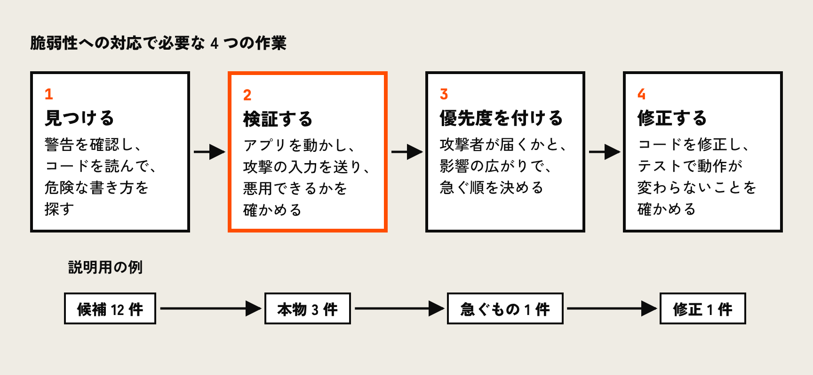
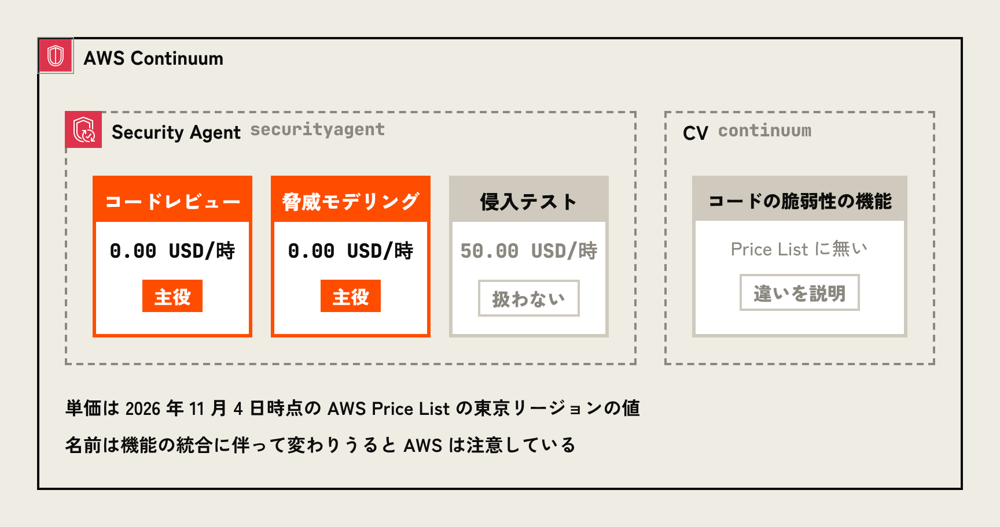
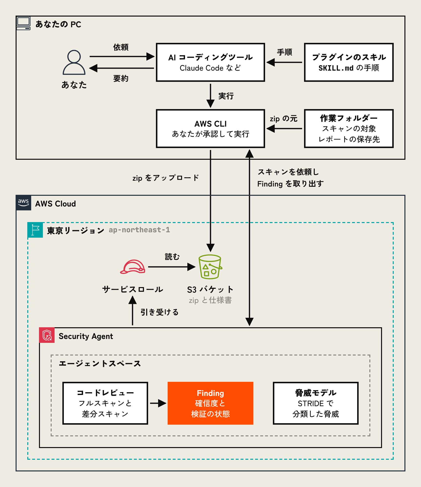
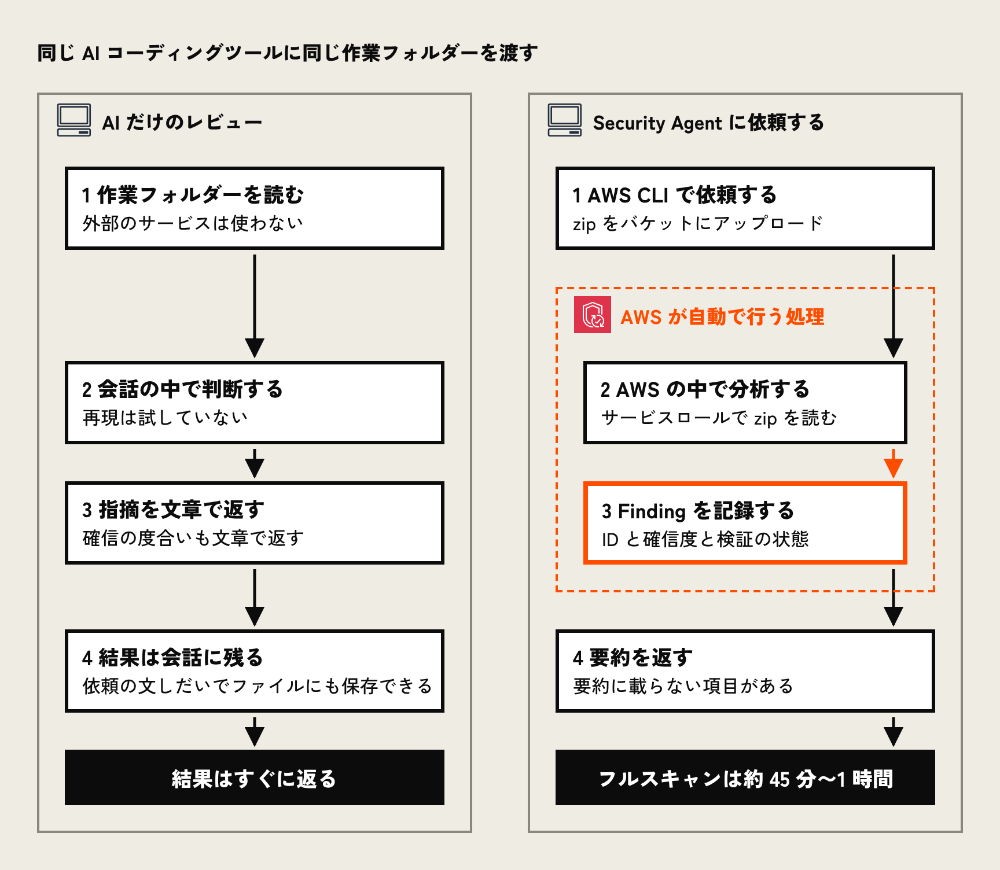
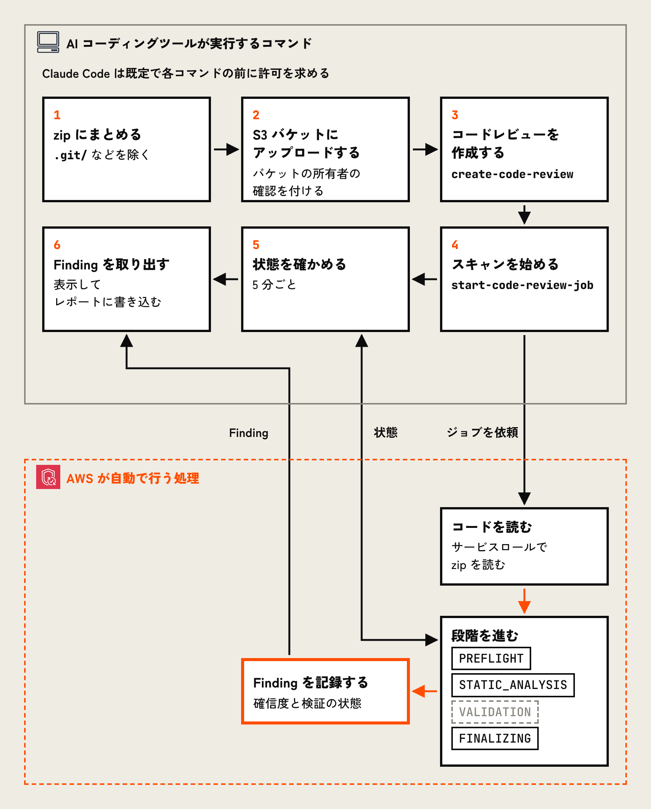
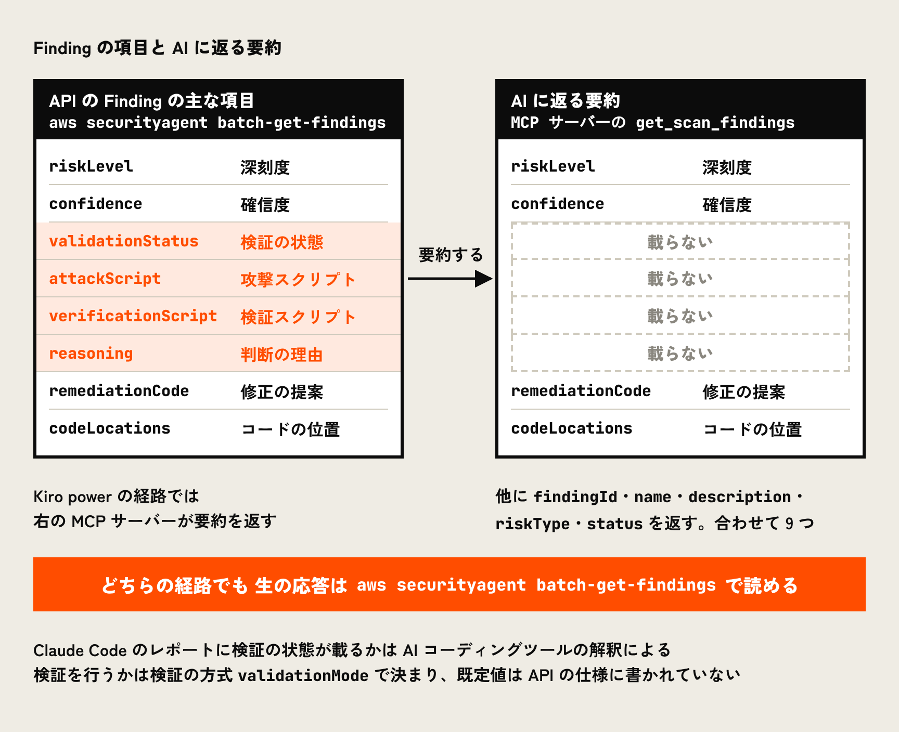
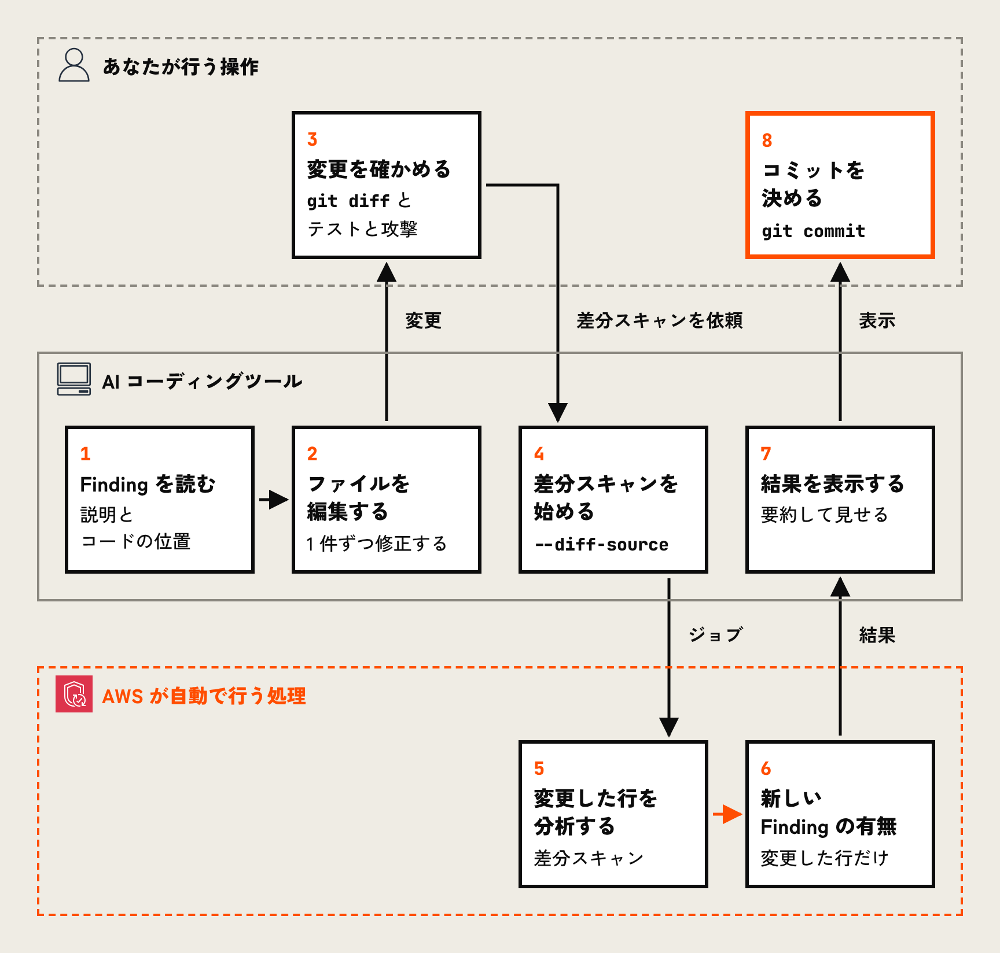
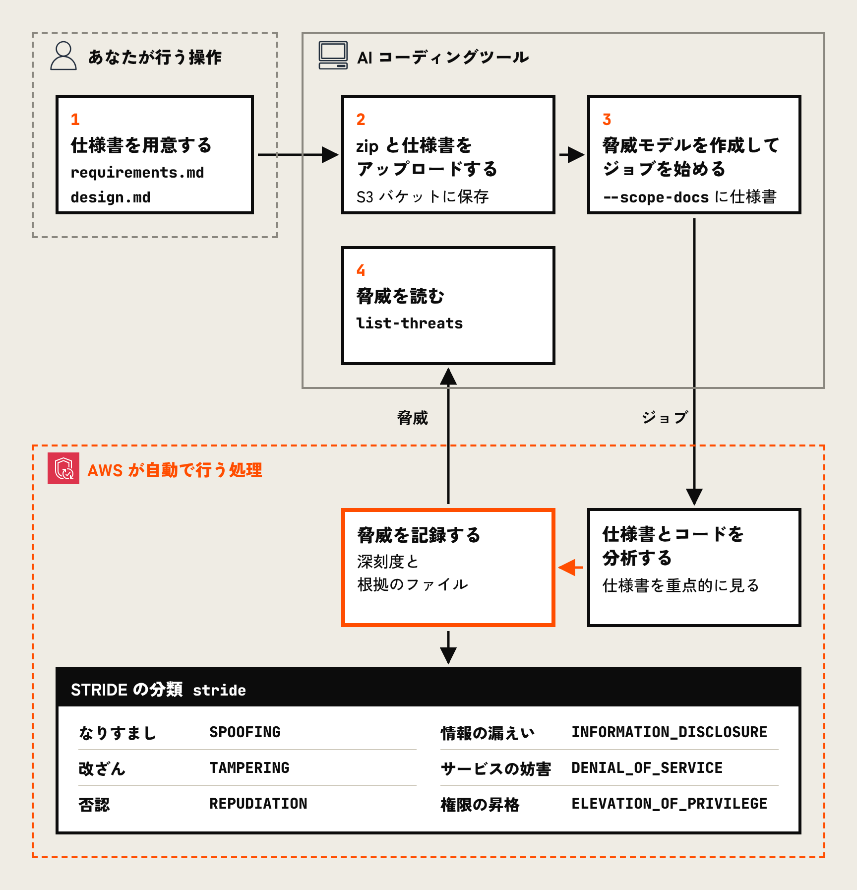
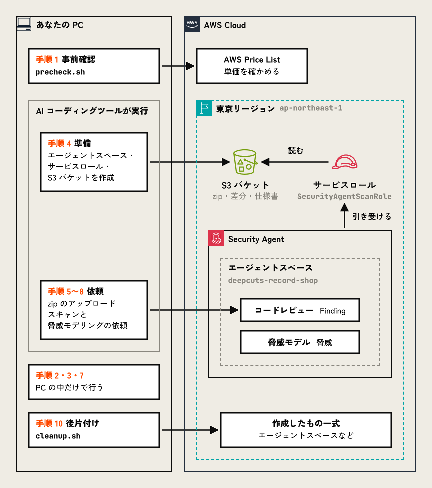

:::note info
AWS Deep Cuts の GitHub はこちらです。
https://github.com/AWS-Deep-Cuts/AWS-Deep-Cuts
:::

# AWS Deep Cutsとは？
AWS Deep Cutsは、AWS の最新のサービスやニッチな機能、または高度にアカデミックな知識を要求するサービスなど、多くの人が知らない 『隠れた名曲 = **Deep Cuts**』 を深くまで掘り下げる技術シリーズです。

このようなサービスはWeb情報も少なく、初学者は気軽にキャッチアップできないのが実情です。

そこで AWS Deep Cuts シリーズでは、**前提知識も含めた分かりやすいサービス解説** と **手順通りに進めれば誰でも再現できるハンズオン** を提供します！

# そもそも脆弱性の検証とは？
Node.js のプロジェクトで `npm install` を実行すると、最後に「12 vulnerabilities (3 moderate, 9 high)」のような警告が表示されることがあります。この数字を見て、すべてすぐに修正すべきか迷ったことはありませんか？

この警告は、プロジェクトが使っているライブラリの版に、既知の脆弱性があることを示しています。**脆弱性**とは、攻撃者が悪用できるプログラムの欠陥です。ただし、警告が示すのは、脆弱性を含む版を使っていることまでです。あなたのアプリがその脆弱な部分を実際に使っているか、攻撃者がそこまで届くかは、警告からは分かりません。

同じ迷いは、ライブラリではなく自分たちが書いたコードの脆弱性でも起きます。この記事が扱うのは、自分たちが書いたコードの脆弱性です。最近は、Claude Code や Kiro のように、コードを読み書きし、コマンドの実行まで行う AI のツールに「このコードに脆弱性はある？」と聞く人も多いと思います。このような AI のツールを、**AI コーディングツール**と呼びます。AI コーディングツールは、それらしい指摘を理由付きで返してくれます。ところが、指摘された箇所を読むと、入力は数行前で決まった値だけに制限されていて、実際には悪用できないことがあります。このように、実際には悪用できないのに脆弱性として報告されたものを、**誤検知**と呼びます。

指摘が誤検知かどうかを見分けるには、その脆弱性を本当に**悪用できる**かを確かめる必要があります。悪用できるとは、攻撃者がその欠陥を使って、データを盗み出したりアプリの動作を変えたりできることです。この確かめる作業を、**検証**と呼びます。コードを読むだけでは、入力がどこで制限されているかを見落とすことがあります。そのため、検証には、多くの場合、アプリを動かせる環境を用意し、攻撃の入力を作成して実際に送る作業が必要です。

脆弱性への対応は、検証を含めて、次の 4 つの作業に分けられます。

| 作業 | 何をするか | 人が行うときに必要なこと |
| --- | --- | --- |
| 見つける | スキャナーの警告を確認し、コードを読んで、危険な書き方を探す | 検査のツールの実行と、コードを読む時間 |
| 検証する | アプリを動かし、攻撃の入力を送って、悪用できるかを確かめる | アプリを動かせる環境と、攻撃の入力を作成する知識 |
| 優先度を付ける | 攻撃者が届くかと、影響の広がりで、急ぐ順を決める | アプリの公開範囲と、アプリが扱うデータの知識 |
| 修正する | コードを修正し、テストで動作が変わらないことを確かめる | 修正の方法の知識と、テスト |

次の図の下の段の件数は、作業を進めるごとに対応すべきものが絞り込まれる様子を示す説明用の例です。



件数が多いと、4 つの作業を人が順に行うには時間がかかります。筆者の考えでは、中でも検証は、1 件ずつ環境を用意して試す必要があるため、手間のかかる作業です。

ここで、冒頭の AI コーディングツールに戻ります。AI コーディングツールのように、人の依頼を達成するために、ツールの実行のような操作まで自動で行う AI を、**AI エージェント**と呼びます。AWS は、セキュリティの作業を行う AI エージェントの機能を、**AWS Continuum** としてまとめて提供しています。そして、その一部の機能には、手元の AI コーディングツールから分析を依頼できます。

# AWS Continuumとは？
AWS Continuum は、セキュリティの作業を行う AWS の AI エージェントの機能の総称で、2026 年 6 月に発表されました。AWS が公開しているセキュリティサービスのベストプラクティス集によると、以前からあった AWS Security Agent も、その一部です。なお、製品とコンソールの名前は機能の統合に伴って変わる可能性があると、同じベストプラクティス集は注意しています。

AWS Continuum の主な機能と、この記事での扱いは、次のとおりです。単価は、AWS の価格表である AWS Price List の、2026 年 11 月 4 日時点の東京リージョンの値です。API の名前は、AWS CLI のコマンドで `aws` の次に書く名前です。

| 機能 | API の名前 | 単価 | この記事での扱い |
| --- | --- | --- | --- |
| コードレビュー | `securityagent` | 0.00 USD/時 | 記事とハンズオンの主役 |
| 脅威モデリング | `securityagent` | 0.00 USD/時 | 記事とハンズオンの主役 |
| 侵入テスト | `securityagent` | 50.00 USD/時 | 名前と単価だけを紹介する |
| Continuum for Code Vulnerabilities（CV） | `continuum` | Price List に無い | 「CVとの違い」の節で説明する |

表の上の 3 つは、AWS Security Agent の API である `securityagent` の機能です。この記事では、`securityagent` の API の機能を **Security Agent** と書きます。表の最後の行の **CV** は、`continuum` の API の機能で、コードの脆弱性を見つけ、コードをビルドしてから検証し、修正パッチを作成します。表の**侵入テスト**は、動いているアプリに対して、実際に攻撃を試す機能です。



この記事とハンズオンの主役は、Security Agent の**コードレビュー**と**脅威モデリング**です。コードレビューは、Security Agent が、渡されたコードを分析して脆弱性を探す機能です。コードレビューの 1 回の実行を**スキャン**と呼び、コード全体を分析するスキャンを**フルスキャン**と呼びます。脅威モデリングは、設計の段階で、システムのどこがどのように攻撃されうるかを洗い出す作業で、Security Agent はこの作業を AI エージェントとして行います。AWS の発表によると、2 つの機能はプレビュー中で、プレビューの間は追加料金がかかりません。

公式のベストプラクティス集は、Amazon Inspector のコードの検査と Security Agent の違いを、「コードに既知の脆弱性が含まれるか」に答えるか、「そのうちどれが本当に悪用できるか」に答えるかの違いとして説明しています。前の章の 4 つの作業で言えば、Security Agent は、検証に関わる問いに答える機能として位置付けられています。

Security Agent は、手元の AI コーディングツールからも使えます。コンソールを開かずに、普段コードを書いている会話の中で、スキャンの依頼から修正までを続けて行えるのが利点です。Claude Code では、AWS 公式の Agent Toolkit for AWS にある**プラグイン** `aws-agents-for-devsecops` を使います。プラグインは、AI コーディングツールに機能をまとめて追加するものです。このプラグインの中心は、**Agent Skill** と呼ばれる手順書です。Agent Skill は、AI が読み込んで従う手順を書いた `SKILL.md` という名前のファイルで、以降は単にスキルとも書きます。プラグインには Security Agent のスキルが 6 つあり、準備・フルスキャン・差分スキャン・脅威モデリング・Finding の取り出しと修正・侵入テストの手順を定めています。

Kiro では、AWS の発表とユーザーガイドによると、**Kiro power** を使います。Kiro power は、Kiro 向けに、MCP サーバーの設定と指示をまとめたものです。**MCP サーバー**は、Model Context Protocol という共通の方式で、AI コーディングツールに道具を提供するプログラムです。AWS Labs は Security Agent の MCP サーバーを公開しており、その README は、MCP に対応したどのクライアントからでも使えると説明しています。

| AI コーディングツール | 使うもの | 根拠 |
| --- | --- | --- |
| Claude Code | プラグイン `aws-agents-for-devsecops` | Agent Toolkit for AWS の README とプラグインの中身。この記事のハンズオンで使う |
| Codex・Cursor・Devin | 同じプラグイン | Agent Toolkit for AWS の README |
| Kiro | Kiro power。MCP サーバーを手動で設定することもできる | AWS の発表とユーザーガイド |
| GitHub Copilot | AWS の資料には記載が無い。GitHub の文書によると MCP サーバーを追加できるため、MCP サーバーをつなげば使える見込みがある | 筆者は確かめていない |

なお、Claude Code のプラグインには、DevOps Agent という別の AI エージェントのスキルも入っていますが、この記事では扱いません。以降は、主に Claude Code の経路を説明します。Claude Code からプラグインで Security Agent を使うときの全体像は、次の図のとおりです。図の上はあなたの PC、下は AWS の東京リージョンです。



図の上の段から順に説明します。あなたが AI コーディングツールに「このディレクトリをスキャンして」のように依頼すると、AI コーディングツールはプラグインのスキルを読み込み、その手順に従います。スキルに書かれているのは、主に AWS CLI のコマンドです。AI コーディングツールは、AWS CLI のコマンドを 1 つずつ実行します。Claude Code は、既定の設定では、多くのコマンドについて、実行する前にあなたに許可を求めます。
<!-- 要確認: Claude Code の実機で、aws コマンドと作業フォルダーの外への書き込みで許可を求められるか -->

スキャンの対象は、AI コーディングツールを起動したフォルダーです。この記事では、このフォルダーを**作業フォルダー**と呼びます。AI コーディングツールは、作業フォルダーを zip にまとめ、あなたのアカウントの S3 バケットにアップロードします。

図の下の段が、AWS の中です。Security Agent の作業は、**エージェントスペース**という単位で管理され、後で説明するコードレビュー・脅威モデル・Finding はすべてここに属します。Security Agent は、あなたのバケットを直接は読めないため、**サービスロール**という IAM ロールを引き受けて、ロールに付いた読み取りの権限で zip を読みます。

分析が終わると、Security Agent は、見つけた脆弱性を 1 件ずつ **Finding** として記録します。AI コーディングツールは AWS CLI で Finding を取り出し、要約して画面に表示し、作業フォルダーの中の `.security-agent/` というフォルダーにレポートを書き込みます。あなたは、この要約とレポートを読みます。

AI コーディングツールから Security Agent を使う方法には、次の特徴があります。

- **分析するのは AWS 側の Security Agent**
  AI コーディングツールが行うのは、分析の依頼と結果の取りまとめです。脆弱性を探す分析そのものは、AWS 側の Security Agent が行います。スキルは公開されているため、AI コーディングツールが実行するコマンドを事前に確認できます。
- **Finding は確信度と検証の状態を持つ**
  Finding は、本物の脆弱性である見込みを表す確信度と、悪用できるかの検証を試みた結果を表す検証の状態を、API の項目として持ちます。
- **修正するのは手元の AI コーディングツール**
  Finding をもとに手元のファイルを修正するのは AI コーディングツールで、適用するかどうかはあなたが決めます。
- **設計の段階で脅威を洗い出せる**
  これから開発する機能の仕様書を渡して、脅威モデリングを行えます。
- **コードレビューと脅威モデリングは 0.00 USD/時**
  2026 年 11 月 4 日時点の Price List の単価です。コードレビューには予算の上限も設定できます。
- **東京リージョンで使える見込み**
  2026 年 11 月 4 日の時点で、東京リージョンのエンドポイントを DNS で確認でき、Price List にも東京の単価があります。ただし、機能ごとの提供リージョンの一覧は確認できていません。<!-- 要確認: 東京リージョンでコードレビューと脅威モデリングを使えるか。著者の実機の結果で、断定するか書き直す -->

# 仕組み
ここからは、全体像の図に沿って、準備・1 回のフルスキャン・Finding の読み方・修正と差分スキャン・脅威モデリングの順に、それぞれの段階で何が起きるのかを説明します。最後に、CV との違いと料金を説明します。

各節に入る前に、冒頭の場面のように AI コーディングツールだけにコードを読ませる場合と、Security Agent に依頼する場合の違いを、図で確かめておきます。この記事では、Security Agent を使わずに、AI コーディングツールにコードを読ませて脆弱性を探させることを、**AI だけのレビュー**と呼びます。



図の左の AI だけのレビューでは、AI コーディングツールがファイルを読み、会話の中で判断して、指摘と確信の度合いを文章で返します。図の右では、1 の依頼と 4 の要約を AI コーディングツールが行い、2 の分析と 3 の記録を AWS 側の Security Agent が行います。右の 4 にある、要約に載らない項目は、「Finding を読む」の節で説明します。

## 準備：エージェントスペースとサービスロールとバケット
Security Agent にスキャンを依頼する前に、全体像の図の下の段にあるエージェントスペース・サービスロール・S3 バケットを用意します。Claude Code では、次のコマンドでプラグインを追加し、準備のスキルを実行します。

```text
/plugin install aws-agents-for-devsecops@claude-plugins-official
/reload-plugins
/aws-agents-for-devsecops:setup-security-agent
```

`/` で始まる行は、Claude Code に入力するコマンドです。1 行目と 2 行目でプラグインを追加して読み込み、3 行目で Security Agent の準備のスキルを実行します。準備のスキルは、次の 3 つを作成するか、既にあれば再利用し、ロールとバケットをエージェントスペースに登録します。

| 作成するもの | 名前 | 役割 |
| --- | --- | --- |
| エージェントスペース | 既定は `security-scans` | コードレビュー・脅威モデル・Finding が属する単位 |
| サービスロール | `SecurityAgentScanRole` | Security Agent が引き受けて、バケットのコードを読む IAM ロール |
| S3 バケット | `security-agent-scans-<アカウント ID>-<リージョン>` | 作業フォルダーの zip をアップロードする先 |

既存のエージェントスペースがある場合、スキルは自動では選ばずに、再利用するか新しく作成するかをあなたに確かめます。

サービスロールには、**信頼ポリシー**が設定されます。信頼ポリシーは、その IAM ロールを誰が引き受けてよいかを決めるポリシーです。準備のスキルが作成する信頼ポリシーは、次のとおりです。アカウント ID は、説明用の値 111122223333 にしています。

```json
{
  "Version": "2012-10-17",
  "Statement": [
    {
      "Effect": "Allow",
      "Principal": { "Service": "securityagent.amazonaws.com" },
      "Action": "sts:AssumeRole",
      "Condition": { "StringEquals": { "aws:SourceAccount": "111122223333" } }
    }
  ]
}
```

`Principal` の `securityagent.amazonaws.com` は、Security Agent のサービスを表す名前です。`Condition` の `aws:SourceAccount` は、ロールを使う処理がどのアカウントのために行われるかを表す条件キーです。この条件により、Security Agent は、あなたのアカウントのための処理でだけ、このロールを引き受けられます。ロールに付与される権限は、そのバケットの読み取りと、`/aws/securityagent/` で始まる CloudWatch Logs のロググループへの書き込みです。

バケットの名前は、アカウント ID とリージョンから決まります。アカウント ID は秘密の情報ではないため、他人が先に同じ名前のバケットを自分のアカウントに作成するおそれがあります。そこで、スキルは、すべての S3 の操作に `--expected-bucket-owner` を付けるよう定めています。この指定を、この記事では**バケットの所有者の確認**と呼びます。バケットの持ち主があなたのアカウントでなければ、S3 は操作を拒否し、スキルは準備を中止します。さらに、スキルはバケットに、パブリックアクセスのブロックと、30 日でオブジェクトを削除するライフサイクルの設定を付けます。

ただし、筆者が AWS CLI 2.39.0 で、接続せずにパラメータの検証だけを試したところ、スキルが書く `aws s3 cp` は `--expected-bucket-owner` を受け付けませんでした。AI コーディングツールが `aws s3api put-object` などに置き換えるかは、承認の前にコマンドを読んで確かめます。
<!-- 要確認: 著者の実機で、AI コーディングツールが aws s3 cp をどう置き換えたか。スキルの見本の create-bucket・put-public-access-block・put-bucket-lifecycle-configuration には --expected-bucket-owner が付いていない -->

プラグインは、作成したエージェントスペースの ID などを、作業フォルダーの `.security-agent/` に保存します。このフォルダーには攻撃の手順になりうる Finding の詳細も書き込まれるため、Git に登録されないよう、中身が `*` だけの `.gitignore` も配置されます。

:::note info
**リージョンの指定**
スキルの AWS CLI のコマンドには、リージョンを指定する `--region` がありません。そのため、AWS CLI は、環境変数かプロファイルの設定のリージョンに接続します。また、スキルは、バケットの名前に使うリージョンを環境変数 `AWS_REGION` から決め、無ければ us-east-1 を使います。東京リージョンで使うときは、AI コーディングツールを起動する前に、環境変数 `AWS_REGION` と `AWS_DEFAULT_REGION` に `ap-northeast-1` を設定しておきます。
:::

:::note warn
ユーザーガイドによると、Security Agent をコンソールで初めて使うときには初回の設定があり、最初のエージェントスペースと Web アプリ用の IAM ロールが作成されます。この設定をしていないアカウントで、プラグインの準備だけで使えるかは、公式の資料からは分かりませんでした。
:::
<!-- 要確認: コンソールの初回の設定をしていないアカウントで /aws-agents-for-devsecops:setup-security-agent が通るか。著者の実機の結果で、この注記を書き直す。初回の設定の内容は検索の要約による -->

## 1 回のフルスキャンで起きること
準備ができたら、AI コーディングツールに「AWS Security Agent で、このディレクトリのフルスキャンを実行してください」のように依頼します。スキルの規則により、AI コーディングツールは、スキャンを自動では始めず、実行してよいかをあなたに確かめます。

次の図は、1 回のフルスキャンで、AI コーディングツールと AWS がそれぞれ何をするかを示しています。図の番号は、下の説明の番号と対応しています。



1. AI コーディングツールが、作業フォルダーを zip にまとめます。`.git/`・`.security-agent/`・`node_modules/` などは除きます。
2. zip を S3 バケットにアップロードします。スキルは、このアップロードにもバケットの所有者の確認を付けるよう定めています。ただし、準備の節で説明したとおり、スキルが書く `aws s3 cp` は、筆者が試した AWS CLI 2.39.0 ではこの指定を受け付けませんでした。
3. `create-code-review` で、コードレビューを作成します。API の上のコードレビューは、どのコードを、どのサービスロールで分析させるかを決めた設定です。スキルは、作業フォルダーごとにコードレビューを 1 つ作成し、2 回目からは再利用します。
4. `start-code-review-job` で、スキャンを始めます。API では、スキャンの 1 回の実行を**ジョブ**と呼びます。
5. 5 分ごとに `batch-get-code-review-jobs` で、ジョブの状態を確かめます。
6. ジョブが終わると、Finding を取り出し、影響の大きさごとにまとめて表示し、`.security-agent/findings-<スキャンの ID>.md` に書き込みます。

3 と 4 で AI コーディングツールが実行するコマンドは、スキルでは次の形で書かれています。`<>` の部分には、準備で作成したリソースの値が入ります。作業フォルダーの ID は、スキルが作業フォルダーの絶対パスから計算する値です。

```bash
aws securityagent create-code-review --agent-space-id <エージェントスペースの ID> --title <題> \
  --service-role <サービスロールの ARN> \
  --assets 'sourceCode=[{s3Location=s3://<バケット>/security-scans/source/<作業フォルダーの ID>/source.zip}]'
aws securityagent start-code-review-job --agent-space-id <エージェントスペースの ID> --code-review-id <コードレビューの ID>
```

AWS の中では、ジョブを受けた Security Agent が、サービスロールでバケットの zip を読み、分析を進めます。API の仕様では、ジョブは `PREFLIGHT`・`STATIC_ANALYSIS`・`FINALIZING` などの段階を進みます。段階の名前の一覧には、`VALIDATION` もあります。どの段階が実際に現れるかは、ハンズオンで観察します。

所要時間は、スキルの記述では約 45 分、ユーザーガイドによると約 1 時間です。始めたジョブは、`stop-code-review-job` で止められます。
<!-- 要確認: ユーザーガイドの所要時間は検索の要約による。著者の実測で補う -->

:::note info
AI コーディングツールは、スキャンを待つ間も 5 分ごとに状態を確かめるため、その分の利用量を使います。スキルによると、確認をやめるように頼めば確認を止め、後で結果を見せるように頼めば Finding を表示します。ジョブは、確認を止めても AWS の中で進みます。
:::

## Finding を読む
AI コーディングツールが表示する要約は、読みやすくまとまっています。ただし、Security Agent が Finding に付けた情報のうち、悪用できるかの判断に役立つ項目が、要約に入らないことがあります。この節では、Finding が API の上でどのような項目を持つのかを確認し、要約と比べます。

API の仕様では、Finding は主に次の項目を持ちます。

| 項目 | この記事での呼び名 | 内容 |
| --- | --- | --- |
| `riskLevel` | 深刻度 | 影響の大きさ。`UNKNOWN`・`INFORMATIONAL`・`LOW`・`MEDIUM`・`HIGH`・`CRITICAL` |
| `confidence` | 確信度 | 本物の脆弱性である見込み。`FALSE_POSITIVE`・`UNCONFIRMED`・`LOW`・`MEDIUM`・`HIGH` |
| `validationStatus` | シミュレーションによる検証の状態 | 悪用の再現を試みた結果。`CONFIRMED`・`NOT_REPRODUCED`・`VALIDATION_FAILED`・`VALIDATING`・`NOT_VALIDATED` |
| `attackScript` | 攻撃スクリプト | Finding を再現するために使ったスクリプト |
| `verificationScript` | 検証スクリプト | 利用者が自分で再現するためのスクリプトの入手先と手順 |
| `reasoning` | 判断の理由 | 脆弱性と判断した理由 |
| `remediationCode` | 修正の提案 | 修正の説明とコード例 |
| `codeLocations` | コードの位置 | 脆弱性に関わるファイルと行。位置ごとに役割を表す札が付く |

以降、シミュレーションによる検証の状態を、短く**検証の状態**と書きます。

具体的な Finding の形を、架空のアプリの例で確認します。この章の例は、ハンズオンのアプリとは別のアプリです。例にするのは、社内の在庫を検索する小さな API で、`GET /items?q=<語>` に送った語を名前に含む商品の在庫を返します。この API のデータベースには、取引先の担当者の連絡先を保存した表 `suppliers` もあります。

この API に、**SQL インジェクション**の脆弱性があるとします。SQL インジェクションは、利用者の入力をそのまま SQL 文につなげるために、攻撃者が SQL 文を書き換えられる脆弱性です。次の JSON は、API の仕様をもとに作成した説明用の例で、Finding の主な項目だけを抜き出しています。`riskType` の値の書き方と `filePath` の形も、説明用の値です。

```json
{
  "name": "SQL injection in item search",
  "riskType": "SQL Injection",
  "riskLevel": "HIGH",
  "confidence": "HIGH",
  "validationStatus": "CONFIRMED",
  "codeLocations": [
    { "filePath": "/.../inventory/api.py", "lineStart": 18, "lineEnd": 18, "label": "source" },
    { "filePath": "/.../inventory/api.py", "lineStart": 24, "lineEnd": 24, "label": "sink" }
  ],
  "attackScript": "curl \"http://localhost:3000/items?q=x' UNION SELECT contact_name, contact_email FROM suppliers -- \"",
  "remediationCode": "Use a parameterized query: cur.execute(\"SELECT ... WHERE name LIKE ?\", (f\"%{q}%\",))"
}
```
<!-- 要確認: riskType の値の書き方と filePath の形を、著者の実機の値で確かめる。この例はハンズオンのアプリの値と重ねないこと -->

`codeLocations` の 2 つの位置には、`label` という札が付いています。API の仕様では、札は脆弱性におけるその位置の役割を表し、例として source と sink が挙がっています。**source** は、攻撃者の入力がプログラムに入る場所です。**sink** は、その入力が危険な処理に届く場所です。この例では、18 行目で受け取った `q` が、24 行目で SQL 文につなげられて実行される状況を想定しています。source から sink までのコードを読めば、途中で入力が制限されているかを自分で確かめられます。

では、AI コーディングツールの要約には、これらの項目のうちどれが載るのでしょうか。Claude Code のプラグインのスキルは、要約に載せる項目をコードでは決めていません。そこで、項目をコードで決めている MCP サーバーを先に見て、どの項目が落ちうるかを確かめます。AWS Labs の Security Agent の MCP サーバーのソースコードを読むと、AI コーディングツールに返す Finding の項目は、`findingId`・`name`・`description`・`riskLevel`・`riskType`・`confidence`・`status`・`remediationCode`・`codeLocations` の 9 つに決められています。検証の状態・攻撃スクリプト・検証スクリプト・判断の理由は、この中に入っていません。ユーザーガイドによると、Kiro power はこの MCP サーバーを使います。



Claude Code のプラグインのスキルは、Finding を AWS CLI の `batch-get-findings` で取り出し、レポートには返された項目をすべて含めるよう指示しています。一方で、同じスキルにあるレポートの見本には、検証の状態・攻撃スクリプト・検証スクリプトがありません。そのため、Claude Code のレポートに検証の状態が載るかどうかは、AI コーディングツールの解釈によります。どちらの経路でも、生の応答は `aws securityagent batch-get-findings` で自分で確認できます。

検証の状態は、AI の要約ではなく生の応答で値を確かめ、値の意味も慎重に読んでください。理由は 2 つあります。

1 つ目に、検証を行うかどうかは、コードレビューの設定で決まり、その設定の値が公開された資料からは分かりません。コードレビューには、**検証の方式** `validationMode` という設定があり、値は `DISABLED` と `SIMULATED` の 2 つです。API の仕様には、この設定の既定値が書かれていません。また、プラグインのスキルも MCP サーバーも、コードレビューを作成するときにこの設定を指定しません。

2 つ目に、シミュレーションによる検証が、どこで何を実行するのかも、API の仕様には書かれていません。AWS の発表によると、スキャナーは Finding を隔離された環境で実行し、悪用の方法を示す証拠を返します。API の仕様で確かなのは、検証の方式と検証の状態の項目があり、検証の状態の値の一覧の説明に sandbox という語があることまでです。

確信度は本物の脆弱性である見込み、検証の状態は悪用の再現を試みた結果で、別の値です。筆者の考えでは、検証の状態が `NOT_VALIDATED` の Finding は、検証を試みていないだけで、悪用できないという意味ではありません。確信度が高い Finding は、検証の状態にかかわらず、source から sink までのコードを自分で読んで判断することを勧めます。

:::note warn
攻撃スクリプトは、あなた自身のシステムを攻撃する手順になりえます。プラグインの修正のスキルは、チャットには Finding の題と件数だけを表示し、攻撃の詳細は、先に `.gitignore` を配置した `.security-agent/` に書き込むよう定めています。Finding の詳細を、他の人と共有したり、Git に登録したりしないでください。
:::

## 修正と差分スキャン
Finding を読んで本物の脆弱性だと判断したら、次は修正です。プラグインを使う場合は、AI コーディングツールが Finding の説明とコードの位置を読み、手元のファイルを編集します。プラグインの修正のスキルは、修正を始める前にあなたに確かめ、1 件ずつ修正するよう定めています。既定で扱うのは、確信度が `HIGH` と `MEDIUM` の Finding だけです。

連携したリポジトリに修正のプルリクエストを作成させる `StartCodeRemediation` という API もありますが、この記事ではリポジトリを連携しないため使いません。修正から確認までの流れは、次の図のとおりです。AI コーディングツールが修正し、あなたが差分とテストと攻撃で確かめてから、AI コーディングツールに差分スキャンを依頼します。



修正の後は、**差分スキャン**で確かめます。差分スキャンは、変更した行だけを分析するスキャンです。差分スキャンのスキルは、コミットしていない変更の `git diff` の結果を `diff.patch` というファイルにし、作業フォルダーの zip と一緒にバケットにアップロードして、`start-code-review-job` に `--diff-source` を付けてジョブを始めます。フルスキャンを先に行っていなくても、差分スキャンは行えます。所要時間は、スキルの記述では数分、ユーザーガイドによると 5〜15 分です。

注意したいのは、差分スキャンが確かめるのは、変更した行に新しい問題が無いかであって、元の Finding が消えたかではないことです。元の Finding が消えたかを確かめるには、もう一度フルスキャンを行います。

図のとおり、修正をコミットするかどうかは、あなたが決めます。筆者は、AI コーディングツールが行った変更の差分を読み、テストを実行し、修正前に成功した攻撃が止まったかを確かめてから、コミットすることを勧めます。攻撃を試すのは、自分の PC で動かした自分のアプリだけにします。

## 脅威モデリング
ここまでのスキャンは、すでに書いたコードの欠陥を探すものでした。一方、これから開発する機能の設計が、今のコードの安全の前提を崩すかどうかは、今のコードだけを読んでも分かりません。たとえば、社内からしか呼ばれない関数を、新しい機能で外部の利用者が呼べるようにすると、その関数の入力の検査が不十分だったことが問題になります。この変化は、今のコードを読むだけでは見えません。筆者の考えでは、こうした問題は、実装する前の設計の段階で洗い出しておくと、修正の手戻りを減らせます。そのための作業が、Security Agent のもう 1 つの主役である脅威モデリングです。

Security Agent は、見つけた脅威を **STRIDE** で分類します。STRIDE は、脅威を次の 6 つに分類する方法で、6 つの英語の頭文字を並べた名前です。

| 分類 | API の値 | 意味 |
| --- | --- | --- |
| なりすまし | `SPOOFING` | 他の利用者やシステムになりすます |
| 改ざん | `TAMPERING` | データやコードを不正に書き換える |
| 否認 | `REPUDIATION` | 行った操作を、行っていないと言い逃れる |
| 情報の漏えい | `INFORMATION_DISCLOSURE` | 見せてはいけない情報が見られる |
| サービスの妨害 | `DENIAL_OF_SERVICE` | サービスを使えなくする |
| 権限の昇格 | `ELEVATION_OF_PRIVILEGE` | 与えられた以上の権限を得る |

脅威モデリングのスキルは、**仕様書**とコードの zip をバケットにアップロードします。仕様書は、脅威モデリングで重点的に見てもらう設計の文書で、`requirements.md` と `design.md` の少なくとも 1 つが必要です。スキルは、`create-threat-model` の `--scope-docs` に仕様書を指定して脅威モデルを作成し、`start-threat-model-job` でジョブを始めます。



ジョブが終わると、AI コーディングツールは `list-threats` で**脅威**を読みます。脅威は、脅威モデリングの結果の 1 件です。API の仕様では、1 件の脅威は主に次の項目を持ちます。

- 題 `title` と文 `statement`
- 深刻度 `severity`。値は `CRITICAL`・`HIGH`・`MEDIUM`・`LOW`・`INFO`
- STRIDE の分類 `stride`
- 前提条件 `prerequisites` と影響 `threatImpact`
- 推奨の対策 `recommendation`
- 根拠のソースファイル `evidence`

所要時間は、ユーザーガイドによると 5〜30 分です。また、ユーザーガイドによると、Kiro の経路では、Kiro が、仕様書のフォルダー `.kiro/specs/` にある `requirements.md` と `design.md` を見つけて送ります。

## CVとの違い
ここまでで、Security Agent のコードレビューと脅威モデリングを説明しました。同じ AWS Continuum の中には、コードの脆弱性を扱うもう 1 つの機能である CV もあります。2 つの違いは、次のとおりです。

| 観点 | Security Agent のコードレビュー | CV |
| --- | --- | --- |
| 東京リージョン | 使える見込み | 使えない。2026 年 11 月 1 日時点で、使えるのはバージニア北部とオレゴンだけ |
| 悪用できるかの確かめ方 | Finding ごとに検証の状態を持つ。検証を行うかは検証の方式で決まる | コードをビルドしてから分析し、検証の証拠を残す |
| 修正 | 修正の提案。連携したリポジトリにはプルリクエスト | `git apply` で適用できる修正パッチ |
| 始めたスキャンを止める操作 | ある | API に無い |
| 予算の上限 | `maxTaskHours` で設定できる | API に設定の項目が無い |
| 単価 | Price List で 0.00 USD/時 | Price List に無い。料金ページによると、行数の料金と推論の料金 |
| AI コーディングツールから使う手段 | プラグイン・Kiro power・MCP サーバー | AWS 公式のプラグインやスキルは見つからなかった |

筆者は、悪用できるという判断の根拠が、実際に試した結果なのか、コードを読んだ推論なのかを、項目から見分けることが大切だと考えます。CV の API は、この区別を項目で表しています。CV の検証の証拠には、実際に送った HTTP リクエストの証明・リポジトリのコードを実際に実行した証明・ソースを読んだだけの分析のうち、多くても 1 つが入ります。ソースを読んだだけの分析の影響は、推論した影響を表す `inferredEffect` という項目に入り、API の説明は、観測した結果と読み違えてはならないと明記しています。

:::note info
**AWS が発表した 89.0% という数字**
AWS の発表によると、AWS Continuum は、CyberGym-E2E というベンチマークの 920 件の課題のうち 819 件に、90 分の制限時間の中で合格し、成功率 89.0% を記録しました。元になった CyberGym は、脆弱な版のプログラムだけを異常終了させる入力をエージェントに作成させるベンチマークで、AWS の発表によると、CyberGym-E2E は C/C++ のプロジェクトのメモリ安全性の脆弱性を対象にしています。この評価は AWS 自身が行ったもので、2026 年 11 月 1 日時点で、第三者による再現は見つかりませんでした。
:::

CV を自分で試したい方のために、ハンズオンのリポジトリには、費用を冒頭に明記した任意の発展の手順も用意しています。
<!-- 要確認: CV の発展の README を公開する場合だけ、この段落を残す -->

## 料金
最後に、ここまでに出てきた機能の料金を整理します。Security Agent の単価は、AWS Price List の次の値です。2026 年 11 月 4 日に取得した東京リージョンの値で、適用開始日は 2026 年 10 月 1 日です。

| 機能 | Price List の使用タイプ | 東京リージョンの単価 |
| --- | --- | --- |
| コードレビュー | `APN1-repository-code-review` | 0.00 USD/時 |
| 脅威モデリング | `APN1-Threat-Modeling` | 0.00 USD/時 |
| 侵入テスト | `APN1-Penetration-Testing` | 50.00 USD/時 |

公式のベストプラクティス集によると、侵入テストの単価の「時」は、エージェントが作業した時間である**タスク時間**で、秒単位で計量されます。平均的なアプリの侵入テストは約 24 タスク時間で、約 1,200 USD かかるため、この記事では扱いません。

AWS の発表によると、コードレビューと脅威モデリングはプレビュー中で、プレビューの間は追加料金がかかりません。一般提供の後の単価は見つかりませんでした。単価が変わった場合に備えて、コードレビューには**予算の上限** `maxTaskHours` を設定できます。API の仕様では、ジョブのタスク時間の合計がこの値に達するとジョブが停止され、設定しない場合は上限なしで実行されます。プラグインのスキルは、この値を指定しません。

CV の単価は、Price List にありません。AWS の料金ページによると、CV の料金は、保護するコードの行数に応じた月額の料金と、CV が行う作業の量に応じた推論の料金の 2 つでできています。行数の料金は最初の 1,000 万行まで 100 万行あたり月 200 USD、推論の料金は CIU（Continuum inference unit）あたり 10 USD です。ハンズオンの任意の発展で CV を 1 回試す場合の目安は、この単価に基づく試算で約 20〜60 USD、仮定に基づく最大で約 260 USD です。
<!-- 要確認: CV の単価は検索の要約による。料金ページの単価と、著者の翌日の請求額で確かめる -->

ハンズオンでは、Security Agent の他に、S3 と、ロググループが作成された場合は CloudWatch Logs の料金がかかります。Price List の単価が 0.00 USD/時のままであれば、ハンズオンの AWS の費用は S3 と CloudWatch Logs の分だけで、0.01 USD 未満の見込みです。この見込みは、ログの量を 1 MB 未満と仮定した値です。実際の請求は、ハンズオンの README の手順に従い、翌日に確かめます。

# AWS Continuumの主な活用事例
ここまでで、Security Agent がコードを分析して Finding を記録し、仕様書から脅威を洗い出せることを説明しました。これらの機能を開発のどの場面で使えるかを紹介します。次の使い方は、API の機能・スキルの記述・AWS の発表をもとに、筆者が整理したものです。

- **コミットやプルリクエストの前の差分スキャン**
  変更した行だけを、数分から 15 分ほどで分析できます。ユーザーガイドによると、Kiro power には、セキュリティに関わる変更の後に差分スキャンを勧める仕組みも含まれています。
- **設計の段階の脅威モデリング**
  新しい機能の仕様書を書いた段階で、実装する前に、STRIDE で分類した脅威を洗い出します。
- **AI が書いたコードの確認**
  AI コーディングツールが書いたコードを、別の AI エージェントである Security Agent に分析させ、確信度と検証の状態の付いた Finding として記録に残します。
- **より深い検証の前の段階**
  動いているアプリに対する侵入テストや、コードをビルドして検証する CV には料金がかかります。その前に、0.00 USD/時のコードレビューで Finding を洗い出しておく使い方が考えられます。

# AWS Continuumを使う際のベストプラクティス
ここまでの仕組みを踏まえて、Security Agent を AI コーディングツールから使うときに守りたいことをまとめます。公式の資料に基づく部分と、筆者の考えを書き分けています。

- **自分が権利を持つコードだけをスキャンする**
  公式のベストプラクティス集によると、Security Agent にアップロードした資料は依頼したリージョンに保存されますが、入力と出力は、同じ地域の中の別のリージョンで処理されることがあります。筆者は、外部のサービスに送ってよいと確かめた、自分か所属する組織のコードだけをスキャンすることを勧めます。
- **AI コーディングツールを起動するフォルダーを分ける**
  プラグインは、作業フォルダー全体を zip にして送ります。秘密の情報や、結果を評価するための答えを含めないようにします。たとえば、練習用の脆弱なアプリ OWASP Juice Shop のリポジトリには、脆弱な行の目印のコメントや正しい修正のファイルが含まれていて、そのままでは AI に答えが見えてしまいます。
- **AI の要約だけでなく生の Finding を読む**
  `batch-get-findings` で、確信度・検証の状態・攻撃スクリプトの有無を確かめます。
- **Finding の詳細を Git に登録しない**
  攻撃スクリプトは攻撃の手順になりえるため、Git に登録せず、他の人とも共有しません。
- **始める前に単価を確かめる**
  Price List で、コードレビューと脅威モデリングの単価を確かめます。筆者は、単価が 0.00 USD/時でなくなったら、`maxTaskHours` で予算の上限を設定することを勧めます。
- **AI コーディングツールが実行するコマンドを読んでから承認する**
  筆者は、コマンドを自動で承認する設定にせず、zip に含まれるファイルやコマンドの内容を読んでから承認することを勧めます。
- **修正は人が確かめてから適用する**
  筆者は、差分・テスト・攻撃の確認をあなたが行ってから、コミットすることを勧めます。
- **侵入テストは許可を得た対象だけに行う**
  侵入テストのスキルは、テストの許可と、対象のドメインの所有の確認を求めます。1 タスク時間あたり 50 USD の費用も見積もってから始めます。

# ハンズオンはこちら！
ハンズオンでは、東京リージョンで、あなたの PC の Claude Code からプラグインを使って Security Agent を動かします。あなたは、Claude Code が実行するコマンドを読んで承認し、作成されたリソースや Finding を、別のターミナルの AWS CLI とコンソールで自分でも確かめます。Kiro は、公式の資料に基づく紹介にとどめています。

題材は、小さなレコード店のアプリです。このアプリには、意図的に入れた脆弱性が 2 つと、危険に見えるが対策済みのコードが 1 つあります。あなたは、アプリを作業フォルダーに複製して脆弱性の場所を予想し、同じ Claude Code に AI だけのレビューとフルスキャンの両方を行わせます。さらに、修正と差分スキャン、仕様書を足した脅威モデリングを行い、最後に、予想・AI だけのレビュー・Security Agent の結果を並べた**採点表**で比べます。GitHub との連携は不要です。この記事の説明用の例は別のアプリのため、記事を読んだ後でも予想は成り立ちます。

Price List の単価が 0.00 USD/時のままであれば、AWS の費用は S3 と CloudWatch Logs の分だけで、0.01 USD 未満の見込みです。事前確認のスクリプトは、始める前に単価が 0.00 USD/時であることを確かめます。実際の請求は、後片付けの翌日に確かめます。AI コーディングツールの利用料は、あなたの契約によります。有料の CV を試す発展の手順は任意です。

ハンズオンの構成は、次の図のとおりです。図の手順の番号は、ハンズオンの README の手順の番号です。



https://github.com/AWS-Deep-Cuts/aws-continuum

# まとめ
AWS Continuum の Security Agent を手元の AI コーディングツールから使うと、AI コーディングツールが依頼と取りまとめを行い、AWS 側の Security Agent がコードを分析して、確信度と検証の状態を付けた Finding を記録します。筆者の整理を 1 文で表すと、**速く広く指摘するのは手元の AI、確信度と検証の状態を付けて記録するのは Security Agent、適用を決めるのは人**です。冒頭で挙げた 4 つの作業で比べると、次のようになります。

| 作業 | AI だけのレビュー | Security Agent に依頼した場合 | 人が確かめること |
| --- | --- | --- | --- |
| 見つける | 会話の中でコードを読み、指摘を文章で返す | AWS 側で分析し、Finding を ID 付きで記録する | 対象が自分の権利のあるコードか。送るフォルダーの中身 |
| 検証する | 理由を文章で説明する。読むだけの頼み方では再現を試さない。再現を頼むと、あなたの PC であなたの権限で実行される | Finding ごとに検証の状態を持つ。検証を行うかは検証の方式で決まる | 検証の状態の値と、source から sink までのコード |
| 優先度を付ける | 会話の中で並べる | 深刻度と確信度を項目として持つ | 確信度の低い Finding の扱い |
| 修正する | 手元のファイルを編集する | 修正の提案を返し、AI コーディングツールが手元で編集する | 差分・テスト・攻撃の確認と、適用の判断 |

普段から AI コーディングツールにコードのセキュリティを聞いている方は、ぜひハンズオンで、いつもの答えと Security Agent の Finding を比べてみてください！

---

<!-- 要確認: docs.aws.amazon.com と aws.amazon.com の URL は執筆時に開けなかった。公開前にリンク先と英語の原題を確かめる -->
参考文献
1. [コードレビューの IDE との統合（Code review IDE integration）](https://docs.aws.amazon.com/securityagent/latest/userguide/code-review-ide-integration.html)
1. [AWS Security Agent のセットアップ（Set up AWS Security Agent）](https://docs.aws.amazon.com/securityagent/latest/userguide/setup-security-agent.html)
1. [AWS Security Agent が Kiro power・Claude Code・シミュレーションによる検証・新しい連携に対応（AWS Security Agent adds Kiro Power, Claude Code, simulated validations and new integrations support）](https://aws.amazon.com/about-aws/whats-new/2026/06/aws-kiro-power-claude-code/)
1. [AWS Security Agent のリポジトリ全体のコードスキャンをプレビューで提供開始（AWS Security Agent full repository code scanning feature now available in preview）](https://aws.amazon.com/blogs/security/aws-security-agent-full-repository-code-scanning-feature-now-available-in-preview/)
<!-- 要確認: 脅威モデリングの What's New（https://aws.amazon.com/about-aws/whats-new/2026/06/aws-security-agent-threat-modeling/）は、英語の原題を確かめてから「日本語訳（英語の原題）」の形で参考文献に戻す。原題は調査の記録に無いため推測で書かない。1 つ前の Security Blog の原題も URL から推した形のため確かめる -->
1. [AWS Continuum のご紹介：マシンスピードで実現するセキュリティ（Introducing AWS Continuum: Security at machine speed）](https://aws.amazon.com/blogs/security/introducing-aws-continuum-security-at-machine-speed/)
1. [Agent Toolkit for AWS の aws-agents-for-devsecops プラグイン（Agent Toolkit for AWS: aws-agents-for-devsecops）](https://github.com/aws/agent-toolkit-for-aws/tree/main/plugins/aws-agents-for-devsecops)
1. [AWS Security Agent の MCP サーバー（AWS Security Agent MCP Server）](https://github.com/awslabs/mcp/tree/main/src/security-agent-mcp-server)
1. [botocore の AWS Security Agent の API の定義（botocore: securityagent 2025-09-06）](https://github.com/boto/botocore/tree/develop/botocore/data/securityagent/2025-09-06)
1. [AWS Price List の AWS Security Agent の東京リージョンの価格（AWS Price List: SecAgent, ap-northeast-1）](https://pricing.us-east-1.amazonaws.com/offers/v1.0/aws/SecAgent/current/ap-northeast-1/index.json)
1. [AWS のセキュリティサービスのベストプラクティス：AWS Security Agent（AWS Security Services Best Practices: AWS Security Agent）](https://aws.github.io/aws-security-services-best-practices/guides/security-agent/)
1. [AWS のセキュリティサービスのベストプラクティス：Amazon Inspector（AWS Security Services Best Practices: Amazon Inspector）](https://aws.github.io/aws-security-services-best-practices/guides/inspector/)
1. [Copilot CLI に MCP サーバーを追加する（Adding MCP servers for GitHub Copilot CLI）](https://docs.github.com/en/copilot/how-tos/copilot-cli/customize-copilot/add-mcp-servers)
<!-- 要確認: GitHub Docs の URL と原題。調査の記録は github/docs の content/copilot/how-tos/copilot-cli/customize-copilot/add-mcp-servers.md のパスだけ -->
1. [botocore の AWS Continuum の API の定義（botocore: continuum 2022-07-26）](https://github.com/boto/botocore/tree/develop/botocore/data/continuum/2022-07-26)
1. [AWS Continuum for Code Vulnerabilities の一般提供開始（AWS Continuum for Code Vulnerabilities is now generally available）](https://aws.amazon.com/blogs/aws/aws-continuum-for-code-vulnerabilities-is-now-generally-available/)
1. [AWS Continuum の料金（AWS Continuum Pricing）](https://aws.amazon.com/continuum/pricing/)
1. [AWS Continuum が自律的なコードセキュリティの新しい基準を打ち立てる（AWS Continuum sets a new standard in autonomous code security）](https://aws.amazon.com/blogs/security/aws-continuum-sets-a-new-standard-in-autonomous-code-security/)
1. [CyberGym のリポジトリ（sunblaze-ucb/cybergym）](https://github.com/sunblaze-ucb/cybergym)
1. [OWASP Juice Shop のリポジトリ（juice-shop/juice-shop）](https://github.com/juice-shop/juice-shop)
